# 🏆 My Certifications & Professional Learning Journey

> **A curated repository showcasing technical learning, industry certifications, virtual internships, and hands-on skill verifications.**

<div align="center">

[](#-certification-statistics)
[](#-issuing-organizations)
[](#-category-wise-index)
[](https://github.com/Rehanraza009/My-Certification)

</div>

---

## 👨‍💻 Candidate Overview

Hello and welcome! I am **Rehan Raza**, a passionate **Computer Science and Engineering (Data Science)** undergraduate at **Galgotias University** *(Student ID: `23SCSE1420011` | Roll No: `23131420121`)*.

My technical journey is driven by intense curiosity and dedication toward mastering modern software engineering, scalable cloud computing, data analytics, and artificial intelligence. This repository documents my structured coursework, national internships, industry simulations, and competitive coding milestones. Every certification listed here has been earned through rigorous problem solving, proctored examinations, or hands-on project implementations.

### 🎯 Core Areas of Interest
- **Data Science & Analytics:** Exploratory data analysis (EDA), data cleaning pipelines, statistical inference, feature engineering, and data storytelling.
- **Machine Learning & Deep Learning:** Supervised and unsupervised algorithms, model evaluation metrics, deep learning architectures, and production MLOps.
- **Artificial Intelligence & Agents:** Autonomous agent architectures, LLM orchestration, prompt engineering, and ethical AI risk management.
- **Cloud Computing (AWS):** Designing scalable data pipelines, data lakes, serverless computing, and managed cloud infrastructure on Amazon Web Services.
- **Full-Stack & Systems Engineering:** End-to-end web architectures using the MERN stack (MongoDB, Express, React, Node.js), event-driven microservices with Kafka, and RESTful APIs.
- **Algorithms & Competitive Programming:** Data Structures and Algorithms in Java and Python with over 250+ problems solved on CodeChef and role assessments verified on HackerRank.

---

## 📑 Table of Contents

1. [Executive Summary & Statistics](#-certification-statistics)
2. [Skills & Technologies Matrix](#-skills--technologies-matrix)
3. [☁️ AWS & Cloud Computing](#aws--cloud-computing) (6 Certificates)
3. [📊 Data Science & Machine Learning](#data-science--machine-learning) (5 Certificates)
3. [🤖 Artificial Intelligence & Autonomous Systems](#artificial-intelligence--autonomous-systems) (5 Certificates)
3. [💻 Programming, Data Structures & Algorithms](#programming-data-structures--algorithms) (13 Certificates)
3. [🌐 Full Stack & Web Engineering](#full-stack--web-engineering) (4 Certificates)
3. [🗄️ Database Management Systems](#database-management-systems) (1 Certificates)
3. [💼 Industry Job Simulations & Virtual Experience](#industry-job-simulations--virtual-experience) (4 Certificates)
3. [💡 Design Thinking & Human-Centered Innovation](#design-thinking--human-centered-innovation) (1 Certificates)
3. [🎖️ General Awareness & Honors](#general-awareness--honors) (1 Certificates)
4. [My Continuous Learning Journey](#-my-continuous-learning-journey)
5. [Repository Structure & Verification Policy](#-repository-structure--verification-policy)

---

## 📈 Certification Statistics

| Metric | Count | Details & Highlights |
| :--- | :---: | :--- |
| **Total Certificates Cataloged** | **`40`** | 100% verified, deduplicated, and preserved in full quality |
| **Issuing Organizations & Partners** | **`12+`** | AWS, IBM, Google for Developers, Oracle Academy, IIT Madras / NPTEL, HackerRank, CodeChef, GUVI, JPMorgan Chase, Deloitte, Tata, Goldman Sachs, Infosys |
| **Technical Domains Covered** | **`9`** | Cloud, Data Science, AI, Full Stack, DSA, Databases, Job Simulations, Design Thinking, General Honors |
| **Competitive Coding Milestone** | **`250+`** | CodeChef Problem Solver Silver Badge |
| **National & Government Recognition** | **`4`** | IIT Madras Elite NPTEL, AICTE EduSkills (x2 Grade 'O'), Ministry of External Affairs |
| **Global Industry Job Simulations** | **`4`** | JPMorgan Chase, Deloitte, Tata Group, Goldman Sachs (via Forage) |

### 🏛️ Category-Wise Breakdown

| Category | Count | Focus Technologies | Quick Link |
| :--- | :---: | :--- | :---: |
| **☁️ AWS & Cloud Computing** | `6` | AWS Data Pipeline, AWS SDKs, Amazon EC2, Amazon S3 | [Explore](#aws--cloud-computing) |
| **📊 Data Science & Machine Learning** | `5` | Complex SQL Joins, Data Science Lifecycle, Data Structures, Data Wrangling | [Explore](#data-science--machine-learning) |
| **🤖 Artificial Intelligence & Autonomous Systems** | `5` | AI Ethics & Governance, AI Literacy, Algorithmic Bias Mitigation, Applied Artificial Intelligence | [Explore](#artificial-intelligence--autonomous-systems) |
| **💻 Programming, Data Structures & Algorithms** | `13` | Competitive Programming, Concurrency Basics, Conditionals & Loops, Data Structure Implementation | [Explore](#programming-data-structures--algorithms) |
| **🌐 Full Stack & Web Engineering** | `4` | Component Lifecycle, Express.js, Express.js Routing, MongoDB | [Explore](#full-stack--web-engineering) |
| **🗄️ Database Management Systems** | `1` | Database Normalization (1NF, 2NF, 3NF), Entity-Relationship (ER) Modeling | [Explore](#database-management-systems) |
| **💼 Industry Job Simulations & Virtual Experience** | `4` | Apache Kafka Streaming, Data Analytics & Profiling, Exploratory Data Analysis, Financial Operations | [Explore](#industry-job-simulations--virtual-experience) |
| **💡 Design Thinking & Human-Centered Innovation** | `1` | Design Thinking Process, Empathy & Needfinding | [Explore](#design-thinking--human-centered-innovation) |
| **🎖️ General Awareness & Honors** | `1` | Indian Foreign Policy Knowledge, International Relations Awareness | [Explore](#general-awareness--honors) |

---

## 🛠️ Skills & Technologies Matrix

The following skills and tools are directly validated by the certificates cataloged in this repository:

### 💻 Programming Languages
 
 
 
 
 

### ☁️ Cloud & MLOps (Amazon Web Services)
 
 
 
 
 
 
 
 

### 📊 Data Science, Machine Learning & AI
 
 
 
 
 
 
 

### 🌐 Full Stack & Backend Technologies
 
 
 
 
 
 

### 📐 Methodologies & Engineering Practices
 
 
 
 

---

## ☁️ AWS & Cloud Computing

> *Comprehensive cloud architecture, serverless engineering, AWS data pipelines, and machine learning operations.*

### 1. AWS Academy Graduate - Data Engineering

<div align="center">
  <a href="AWS-Cloud/AWS-Academy-Graduate-Data-Engineering-Badge.pdf" target="_blank">
    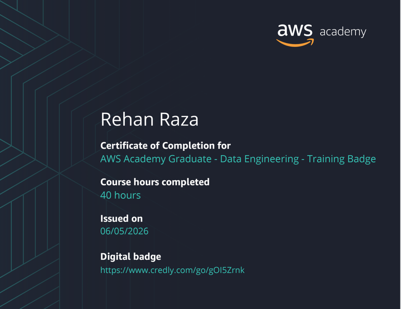
  </a>
  <br /><sub>🔍 <i>Click image to view high-resolution certificate</i></sub>
</div>

| Attribute | Details |
| :--- | :--- |
| **Issuing Organization** | Amazon Web Services (AWS Academy) |
| **Credential Type** | `Training Badge & Course Completion` |
| **Completion / Issue Date** | June 05, 2026 |
| **Credential ID** | `gOI5Zrnk` |
| **Verification URL** | [🔗 Verify Credential Online](https://www.credly.com/go/gOI5Zrnk) |
| **Direct Certificate File** | [📂 Open File: `AWS-Academy-Graduate-Data-Engineering-Badge.pdf`](AWS-Cloud/AWS-Academy-Graduate-Data-Engineering-Badge.pdf) |

**📖 About the Certification:**  
Comprehensive 40-hour hands-on curriculum by AWS Academy focusing on cloud-based data engineering architectures. It covers designing, building, and maintaining robust data processing systems on AWS.

**🧠 Key Concepts Learned:**  
Data ingestion strategies, building scalable data pipelines, data lake architecture with Amazon S3, serverless data warehousing, and managing data security and access controls.

**🎯 Technical Skills Gained:**  
`AWS Data Pipeline`, `Amazon S3`, `AWS Glue`, `Amazon Redshift`, `Amazon Athena`, `ETL Processing`, `Data Lakes`, `IAM`

**🛠️ Tools & Technologies:**  
`AWS Cloud Console`, `AWS Glue`, `Amazon Athena`, `Amazon Redshift`, `Amazon EMR`, `Amazon QuickSight`, `S3`

**🚀 Practical Learning Outcomes:**  
Ability to architect, deploy, and monitor scalable ETL pipelines, ingest streaming and batch data, and execute analytical queries using Athena and Redshift on enterprise AWS environments.

<div align='right'><a href='#-table-of-contents'>⬆ Back to Top</a></div>

---

### 2. AWS Technical Essentials

<div align="center">
  <a href="AWS-Cloud/AWS-Technical-Essentials.pdf" target="_blank">
    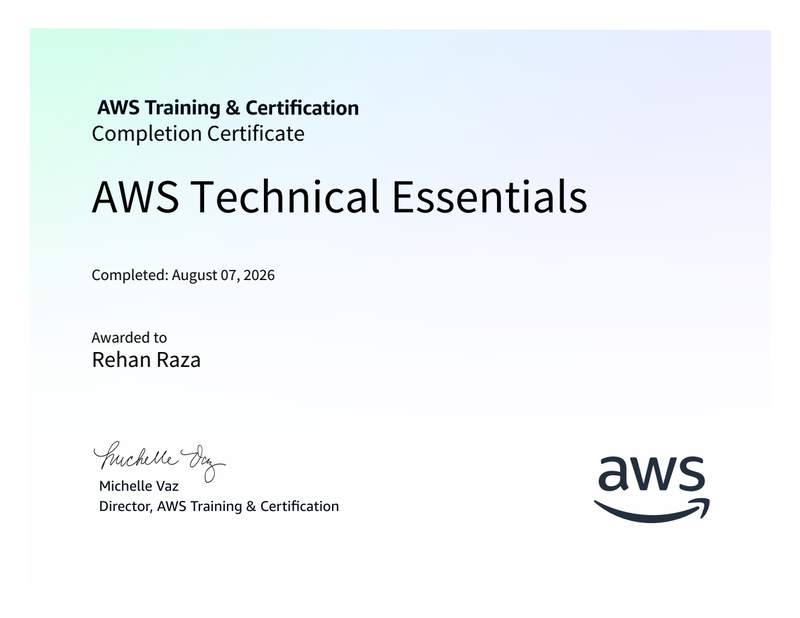
  </a>
  <br /><sub>🔍 <i>Click image to view high-resolution certificate</i></sub>
</div>

| Attribute | Details |
| :--- | :--- |
| **Issuing Organization** | Amazon Web Services (AWS Training & Certification) |
| **Credential Type** | `Course Completion Certificate` |
| **Completion / Issue Date** | August 07, 2026 |
| **Credential ID** | *Not Available* |
| **Verification URL** | *Not Available* |
| **Signatory / Authority** | Michelle Vaz (Director, AWS Training & Certification) |
| **Direct Certificate File** | [📂 Open File: `AWS-Technical-Essentials.pdf`](AWS-Cloud/AWS-Technical-Essentials.pdf) |

**📖 About the Certification:**  
Fundamental technical training on foundational AWS cloud services and best practices. Covers core computing, storage, networking, database, and security architectures on the AWS platform.

**🧠 Key Concepts Learned:**  
AWS global infrastructure concepts, provisioning virtual compute instances, network isolation using VPCs and subnets, object and block storage configurations, and managed database deployments.

**🎯 Technical Skills Gained:**  
`Cloud Computing Architecture`, `Amazon EC2`, `Amazon VPC`, `AWS Identity and Access Management (IAM)`, `Amazon S3 & EBS`, `Elastic Load Balancing`, `Auto Scaling`

**🛠️ Tools & Technologies:**  
`AWS Management Console`, `AWS CLI`, `Amazon EC2`, `Amazon VPC`, `Amazon RDS`

**🚀 Practical Learning Outcomes:**  
Demonstrated understanding of core AWS services, ability to make informed cloud infrastructure choices, and readiness to provision foundational compute, storage, and networking resources.

<div align='right'><a href='#-table-of-contents'>⬆ Back to Top</a></div>

---

### 3. Data Engineering on AWS - Foundations

<div align="center">
  <a href="AWS-Cloud/Data-Engineering-on-AWS-Foundations.pdf" target="_blank">
    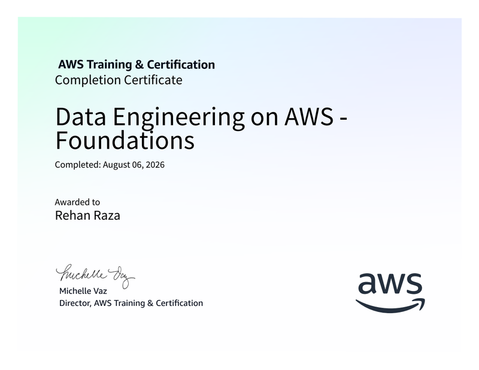
  </a>
  <br /><sub>🔍 <i>Click image to view high-resolution certificate</i></sub>
</div>

| Attribute | Details |
| :--- | :--- |
| **Issuing Organization** | Amazon Web Services (AWS Training & Certification) |
| **Credential Type** | `Course Completion Certificate` |
| **Completion / Issue Date** | August 06, 2026 |
| **Credential ID** | *Not Available* |
| **Verification URL** | *Not Available* |
| **Signatory / Authority** | Michelle Vaz (Director, AWS Training & Certification) |
| **Direct Certificate File** | [📂 Open File: `Data-Engineering-on-AWS-Foundations.pdf`](AWS-Cloud/Data-Engineering-on-AWS-Foundations.pdf) |

**📖 About the Certification:**  
Foundational curriculum exploring the lifecycle of data on AWS cloud platforms. Introduces core design principles for modern data platform architectures and analytical workflows.

**🧠 Key Concepts Learned:**  
Techniques for structured and unstructured data ingestion, data transformation pipelines, cataloging datasets with AWS Glue, and integrating data lakes with data warehouses.

**🎯 Technical Skills Gained:**  
`Data Engineering Concepts`, `Data Modeling`, `ETL Architectures`, `Serverless Data Architectures`, `Data Lake Storage`, `Analytical Querying`

**🛠️ Tools & Technologies:**  
`AWS Glue`, `Amazon Athena`, `Amazon S3`, `Amazon Redshift`, `AWS Lake Formation`

**🚀 Practical Learning Outcomes:**  
Practical knowledge of designing foundational cloud data workflows, structuring data pipelines according to AWS best practices, and evaluating suitable AWS storage and processing options.

<div align='right'><a href='#-table-of-contents'>⬆ Back to Top</a></div>

---

### 4. AWS Developer - Introduction to AWS Developer Learning Plan

<div align="center">
  <a href="AWS-Cloud/AWS-Developer-Introduction-Learning-Plan.pdf" target="_blank">
    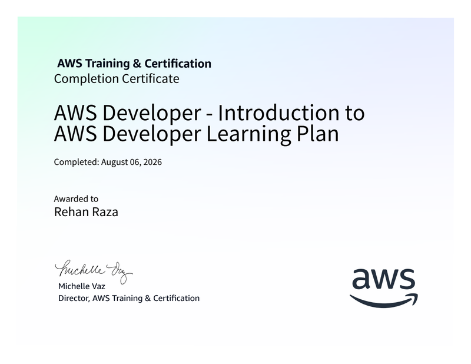
  </a>
  <br /><sub>🔍 <i>Click image to view high-resolution certificate</i></sub>
</div>

| Attribute | Details |
| :--- | :--- |
| **Issuing Organization** | Amazon Web Services (AWS Training & Certification) |
| **Credential Type** | `Learning Plan Completion Certificate` |
| **Completion / Issue Date** | August 06, 2026 |
| **Credential ID** | *Not Available* |
| **Verification URL** | *Not Available* |
| **Signatory / Authority** | Michelle Vaz (Director, AWS Training & Certification) |
| **Direct Certificate File** | [📂 Open File: `AWS-Developer-Introduction-Learning-Plan.pdf`](AWS-Cloud/AWS-Developer-Introduction-Learning-Plan.pdf) |

**📖 About the Certification:**  
Structured learning plan introducing developer workflows, cloud-native application deployment, and serverless architectures on Amazon Web Services.

**🧠 Key Concepts Learned:**  
Interfacing with AWS services programmatically via SDKs, orchestrating serverless functions with AWS Lambda, designing RESTful endpoints with API Gateway, and implementing NoSQL patterns with DynamoDB.

**🎯 Technical Skills Gained:**  
`Cloud Native Development`, `AWS SDKs`, `Serverless Computing`, `Microservices Architecture`, `API Gateway Integration`, `Application Security on AWS`

**🛠️ Tools & Technologies:**  
`AWS Lambda`, `Amazon API Gateway`, `Amazon DynamoDB`, `AWS IAM`, `AWS CloudWatch`

**🚀 Practical Learning Outcomes:**  
Competence in architecting serverless cloud applications, securely connecting client applications to AWS backends, and leveraging cloud-native deployment patterns.

<div align='right'><a href='#-table-of-contents'>⬆ Back to Top</a></div>

---

### 5. AWS ML Engineer Associate Curriculum Overview

<div align="center">
  <a href="AWS-Cloud/AWS-ML-Engineer-Associate-Curriculum-Overview.jpg" target="_blank">
    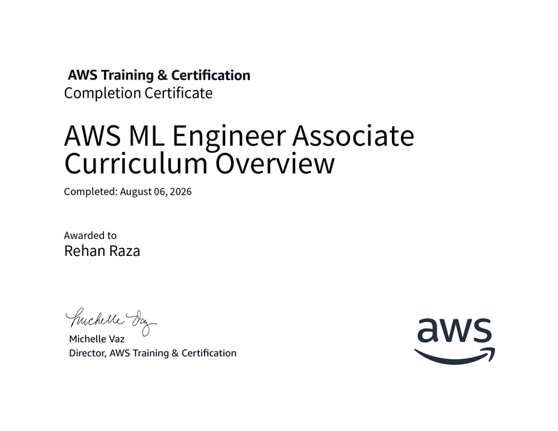
  </a>
  <br /><sub>🔍 <i>Click image to view high-resolution certificate</i></sub>
</div>

| Attribute | Details |
| :--- | :--- |
| **Issuing Organization** | Amazon Web Services (AWS Training & Certification) |
| **Credential Type** | `Curriculum Completion Certificate` |
| **Completion / Issue Date** | August 06, 2026 |
| **Credential ID** | *Not Available* |
| **Verification URL** | *Not Available* |
| **Signatory / Authority** | Michelle Vaz (Director, AWS Training & Certification) |
| **Direct Certificate File** | [📂 Open File: `AWS-ML-Engineer-Associate-Curriculum-Overview.jpg`](AWS-Cloud/AWS-ML-Engineer-Associate-Curriculum-Overview.jpg) |

**📖 About the Certification:**  
Specialized curriculum overview designed for the AWS Certified Machine Learning Engineer Associate pathway, focusing on deploying, maintaining, and monitoring production ML systems.

**🧠 Key Concepts Learned:**  
End-to-end MLOps lifecycles, automated pipeline orchestration using Amazon SageMaker, scaling model endpoints, tracking model drift, and securing ML infrastructure.

**🎯 Technical Skills Gained:**  
`Machine Learning Operations (MLOps)`, `Model Deployment`, `Model Monitoring`, `Feature Engineering on AWS`, `SageMaker Workflows`, `Data Preprocessing`

**🛠️ Tools & Technologies:**  
`Amazon SageMaker`, `AWS Lambda`, `Amazon S3`, `Amazon CloudWatch`

**🚀 Practical Learning Outcomes:**  
Clear technical understanding of enterprise ML engineering practices, containerized model deployment, and monitoring machine learning workloads in high-availability cloud environments.

<div align='right'><a href='#-table-of-contents'>⬆ Back to Top</a></div>

---

### 6. Data Engineering Virtual Internship (8-Weeks)

<div align="center">
  <a href="AWS-Cloud/AWS-Academy-Data-Engineering-Virtual-Internship.pdf" target="_blank">
    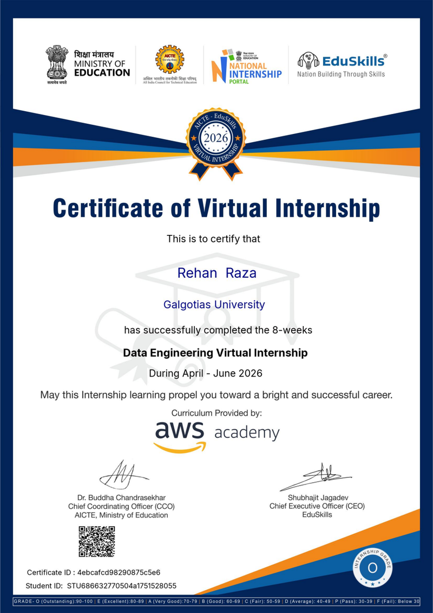
  </a>
  <br /><sub>🔍 <i>Click image to view high-resolution certificate</i></sub>
</div>

| Attribute | Details |
| :--- | :--- |
| **Issuing Organization** | EduSkills & AICTE (Curriculum by AWS Academy) |
| **Credential Type** | `Virtual Internship Certificate` |
| **Completion / Issue Date** | April - June 2026 |
| **Credential ID** | `4ebcafcd98290875c5e6` |
| **Verification URL** | *Not Available* |
| **Grade Awarded** | **O (Outstanding)** |
| **Direct Certificate File** | [📂 Open File: `AWS-Academy-Data-Engineering-Virtual-Internship.pdf`](AWS-Cloud/AWS-Academy-Data-Engineering-Virtual-Internship.pdf) |

**📖 About the Certification:**  
An intensive 8-week virtual internship jointly endorsed by the Ministry of Education (Govt of India), AICTE, and EduSkills with curriculum provided by AWS Academy. Completed with the highest grade 'O' (Outstanding).

**🧠 Key Concepts Learned:**  
Architecting real-world enterprise data flows, configuring secure data ingestion pipelines, handling distributed big data processing, and performing analytics across distributed cloud databases.

**🎯 Technical Skills Gained:**  
`Enterprise Data Engineering`, `Cloud Data Architecture`, `Data Pipeline Orchestration`, `ETL Implementation`, `Big Data Analytics`, `Cloud Security`

**🛠️ Tools & Technologies:**  
`AWS Academy Lab Environment`, `AWS Glue`, `Amazon S3`, `Amazon Athena`, `Amazon Redshift`

**🚀 Practical Learning Outcomes:**  
Demonstrated hands-on experience in building industry-grade cloud data engineering solutions, solving practical big-data problems, and achieving institutional excellence recognized by AICTE.

<div align='right'><a href='#-table-of-contents'>⬆ Back to Top</a></div>

---

## 📊 Data Science & Machine Learning

> *Exploratory data analysis, statistical modeling, machine learning algorithms, and predictive analytics.*

### 1. Data Analysis with Python (DA0101EN)

<div align="center">
  <a href="Data-Science-Machine-Learning/IBM-Data-Analysis-with-Python-DA0101EN.pdf" target="_blank">
    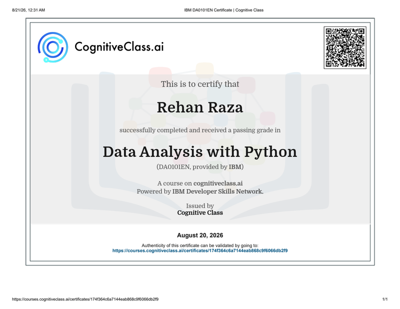
  </a>
  <br /><sub>🔍 <i>Click image to view high-resolution certificate</i></sub>
</div>

| Attribute | Details |
| :--- | :--- |
| **Issuing Organization** | IBM (Powered by IBM Developer Skills Network / Cognitive Class) |
| **Credential Type** | `Course Completion Certificate` |
| **Completion / Issue Date** | August 20, 2026 |
| **Credential ID** | `174f364c6a7144eab868c9f6066db2f9` |
| **Verification URL** | [🔗 Verify Credential Online](https://courses.cognitiveclass.ai/certificates/174f364c6a7144eab868c9f6066db2f9) |
| **Direct Certificate File** | [📂 Open File: `IBM-Data-Analysis-with-Python-DA0101EN.pdf`](Data-Science-Machine-Learning/IBM-Data-Analysis-with-Python-DA0101EN.pdf) |

**📖 About the Certification:**  
In-depth course on data analysis methodologies using Python, covering data cleaning, wrangling, exploratory data analysis, and building statistical prediction models.

**🧠 Key Concepts Learned:**  
Handling missing data, data normalization and binning, correlation and statistical hypothesis testing, multi-variable linear and polynomial regression, and cross-validation techniques.

**🎯 Technical Skills Gained:**  
`Data Wrangling`, `Exploratory Data Analysis (EDA)`, `Model Development`, `Model Evaluation`, `Statistical Data Analysis`, `Regression Analysis`

**🛠️ Tools & Technologies:**  
`Python`, `Pandas`, `NumPy`, `SciPy`, `Matplotlib`, `Seaborn`, `Scikit-learn`

**🚀 Practical Learning Outcomes:**  
Ability to transform raw, messy datasets into structured analytical assets, generate insightful statistical visualizations, and build predictive analytical models.

<div align='right'><a href='#-table-of-contents'>⬆ Back to Top</a></div>

---

### 2. Machine Learning with Python (ML0101EN)

<div align="center">
  <a href="Data-Science-Machine-Learning/IBM-Machine-Learning-with-Python-ML0101EN.pdf" target="_blank">
    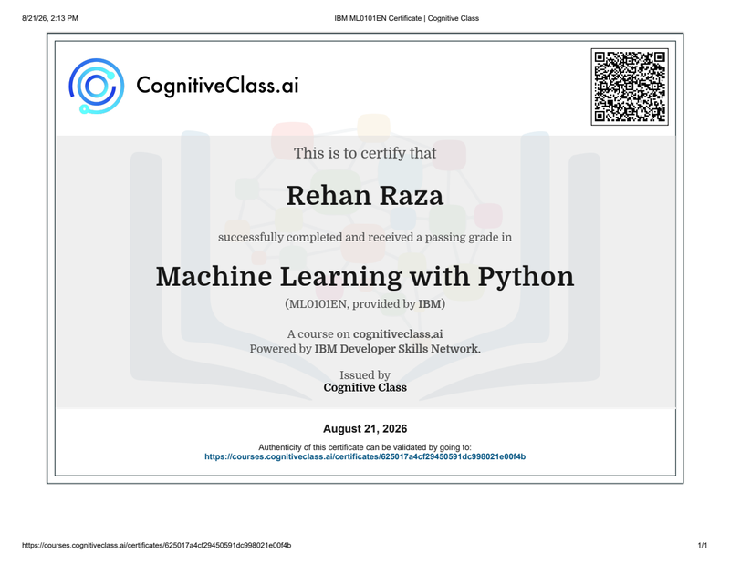
  </a>
  <br /><sub>🔍 <i>Click image to view high-resolution certificate</i></sub>
</div>

| Attribute | Details |
| :--- | :--- |
| **Issuing Organization** | IBM (Powered by IBM Developer Skills Network / Cognitive Class) |
| **Credential Type** | `Course Completion Certificate` |
| **Completion / Issue Date** | August 21, 2026 |
| **Credential ID** | `625017a4cf29450591dc998021e00f4b` |
| **Verification URL** | [🔗 Verify Credential Online](https://courses.cognitiveclass.ai/certificates/625017a4cf29450591dc998021e00f4b) |
| **Direct Certificate File** | [📂 Open File: `IBM-Machine-Learning-with-Python-ML0101EN.pdf`](Data-Science-Machine-Learning/IBM-Machine-Learning-with-Python-ML0101EN.pdf) |

**📖 About the Certification:**  
Comprehensive machine learning curriculum diving into core algorithms, theoretical principles, and practical implementations using Scikit-learn and Python.

**🧠 Key Concepts Learned:**  
Classification with Decision Trees, Logistic Regression, SVM, and KNN; Regression analysis; Clustering with K-Means, Hierarchical, and DBSCAN; and building Content-Based and Collaborative Filtering recommender systems.

**🎯 Technical Skills Gained:**  
`Supervised Learning`, `Unsupervised Learning`, `Classification Algorithms`, `Regression Models`, `Clustering Algorithms`, `Recommender Systems`

**🛠️ Tools & Technologies:**  
`Python`, `Scikit-learn`, `NumPy`, `Pandas`, `Matplotlib`, `SciPy`

**🚀 Practical Learning Outcomes:**  
Proficiency in evaluating machine learning models using Precision, Recall, F1-Score, and Jaccard Index, tuning hyperparameters, and deploying predictive ML pipelines.

<div align='right'><a href='#-table-of-contents'>⬆ Back to Top</a></div>

---

### 3. Python 101 for Data Science (PY0101EN)

<div align="center">
  <a href="Data-Science-Machine-Learning/IBM-Python-101-for-Data-Science-PY0101EN.pdf" target="_blank">
    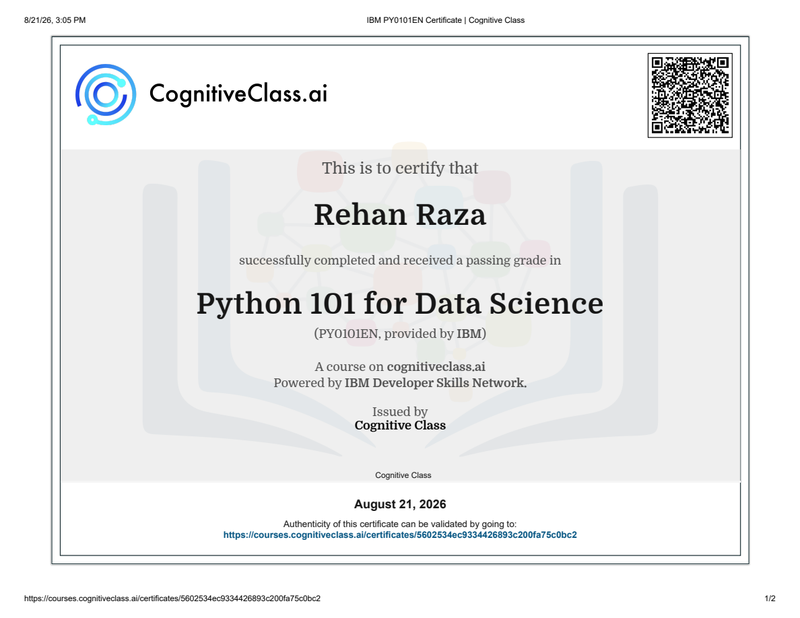
  </a>
  <br /><sub>🔍 <i>Click image to view high-resolution certificate</i></sub>
</div>

| Attribute | Details |
| :--- | :--- |
| **Issuing Organization** | IBM (Powered by IBM Developer Skills Network / Cognitive Class) |
| **Credential Type** | `Course Completion Certificate` |
| **Completion / Issue Date** | August 21, 2026 |
| **Credential ID** | `5602534ec9334426893c200fa75c0bc2` |
| **Verification URL** | [🔗 Verify Credential Online](https://courses.cognitiveclass.ai/certificates/5602534ec9334426893c200fa75c0bc2) |
| **Direct Certificate File** | [📂 Open File: `IBM-Python-101-for-Data-Science-PY0101EN.pdf`](Data-Science-Machine-Learning/IBM-Python-101-for-Data-Science-PY0101EN.pdf) |

**📖 About the Certification:**  
Foundational Python programming course tailored specifically for aspiring data scientists and analysts, delivered under the IBM Developer Skills Network.

**🧠 Key Concepts Learned:**  
Python fundamentals including types, expressions, variables, string operations, lists, tuples, dictionaries, sets, control flows, exception handling, and 1D/2D NumPy computations.

**🎯 Technical Skills Gained:**  
`Python Core Syntax`, `Data Structures`, `File I/O`, `Pandas Basics`, `NumPy Arrays`, `Data Manipulation`

**🛠️ Tools & Technologies:**  
`Python 3`, `Jupyter Notebooks`, `Pandas`, `NumPy`

**🚀 Practical Learning Outcomes:**  
Solid foundation in Python programming suited for scientific computing, algorithmic problem solving, and loading/processing structured datasets.

<div align='right'><a href='#-table-of-contents'>⬆ Back to Top</a></div>

---

### 4. Introduction to Data Science

<div align="center">
  <a href="Data-Science-Machine-Learning/Infosys-Springboard-Introduction-to-Data-Science.pdf" target="_blank">
    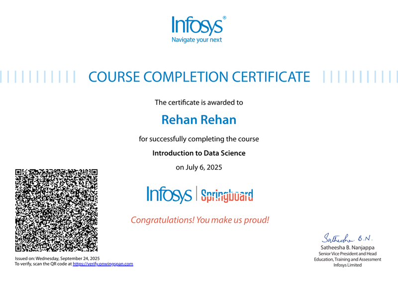
  </a>
  <br /><sub>🔍 <i>Click image to view high-resolution certificate</i></sub>
</div>

| Attribute | Details |
| :--- | :--- |
| **Issuing Organization** | Infosys (Infosys Springboard) |
| **Credential Type** | `Course Completion Certificate` |
| **Completion / Issue Date** | July 6, 2025 (Issued: September 24, 2025) |
| **Credential ID** | *Not Available* |
| **Verification URL** | [🔗 Verify Credential Online](https://verify.onwingspan.com) |
| **Signatory / Authority** | Satheesha B. Nanjappa (Senior Vice President, Infosys Limited) |
| **Direct Certificate File** | [📂 Open File: `Infosys-Springboard-Introduction-to-Data-Science.pdf`](Data-Science-Machine-Learning/Infosys-Springboard-Introduction-to-Data-Science.pdf) |

**📖 About the Certification:**  
Rigorous course offered through Infosys Springboard introducing the end-to-end data science lifecycle, industry data workflows, and data-driven decision-making methodologies.

**🧠 Key Concepts Learned:**  
Understanding data collection strategies, evaluating data quality, conducting statistical data investigations, and effectively interpreting data distributions for business problems.

**🎯 Technical Skills Gained:**  
`Data Science Lifecycle`, `Exploratory Data Analysis`, `Data Collection & Cleaning`, `Statistical Modeling`, `Business Intelligence`

**🛠️ Tools & Technologies:**  
`Python`, `Jupyter`, `Data Science Libraries`

**🚀 Practical Learning Outcomes:**  
Comprehensive understanding of how data science drives corporate innovation, and practical familiarity with data storytelling and exploratory techniques.

<div align='right'><a href='#-table-of-contents'>⬆ Back to Top</a></div>

---

### 5. SQL Roadmap for Data Analysis

<div align="center">
  <a href="Data-Science-Machine-Learning/CodeChef-SQL-Roadmap-for-Data-Analysis.pdf" target="_blank">
    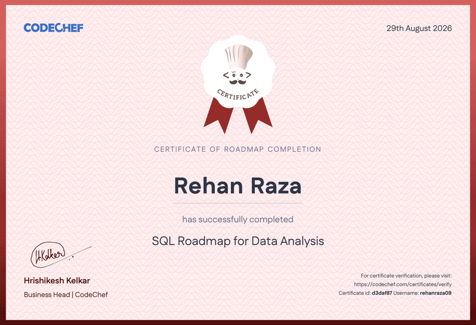
  </a>
  <br /><sub>🔍 <i>Click image to view high-resolution certificate</i></sub>
</div>

| Attribute | Details |
| :--- | :--- |
| **Issuing Organization** | CodeChef |
| **Credential Type** | `Roadmap Completion Certificate` |
| **Completion / Issue Date** | August 29, 2026 |
| **Credential ID** | `d3daf87` |
| **Verification URL** | [🔗 Verify Credential Online](https://codechef.com/certificates/verify) |
| **Direct Certificate File** | [📂 Open File: `CodeChef-SQL-Roadmap-for-Data-Analysis.pdf`](Data-Science-Machine-Learning/CodeChef-SQL-Roadmap-for-Data-Analysis.pdf) |

**📖 About the Certification:**  
Structured curriculum roadmap focused on mastering SQL queries specifically tailored for analytical workloads, reporting, and database insights.

**🧠 Key Concepts Learned:**  
Writing complex multi-table JOINs, leveraging aggregate functions, building common table expressions (CTEs), nested subqueries, and window functions for analytical partitioning.

**🎯 Technical Skills Gained:**  
`Relational Database Querying`, `Complex SQL Joins`, `Aggregations & Grouping`, `Subqueries & CTEs`, `Window Functions`, `Data Filtering & Sorting`

**🛠️ Tools & Technologies:**  
`SQL`, `Relational Database Management Systems`

**🚀 Practical Learning Outcomes:**  
Ability to query, manipulate, and extract actionable insights from large relational databases to support analytical reports and data-driven dashboards.

<div align='right'><a href='#-table-of-contents'>⬆ Back to Top</a></div>

---

## 🤖 Artificial Intelligence & Autonomous Systems

> *Deep learning, autonomous AI agents, ethical AI governance, and industrial AI internships.*

### 1. Responsible AI and Risk Management

<div align="center">
  <a href="Artificial-Intelligence/IBM-SkillsBuild-Responsible-AI-and-Risk-Management.pdf" target="_blank">
    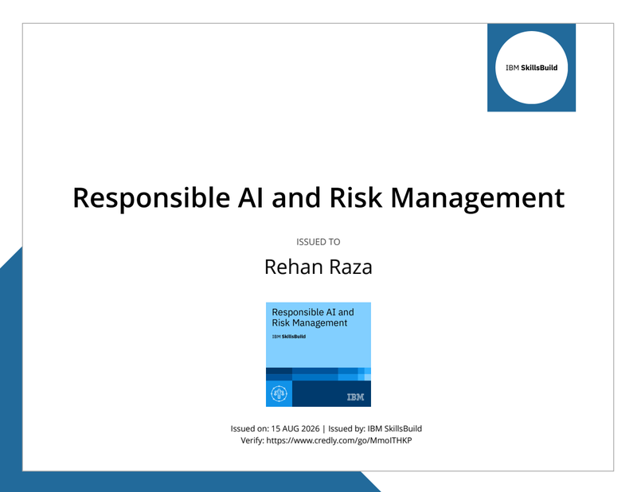
  </a>
  <br /><sub>🔍 <i>Click image to view high-resolution certificate</i></sub>
</div>

| Attribute | Details |
| :--- | :--- |
| **Issuing Organization** | IBM SkillsBuild |
| **Credential Type** | `Professional Training Badge` |
| **Completion / Issue Date** | August 15, 2026 |
| **Credential ID** | `MmoITHKP` |
| **Verification URL** | [🔗 Verify Credential Online](https://www.credly.com/go/MmoITHKP) |
| **Direct Certificate File** | [📂 Open File: `IBM-SkillsBuild-Responsible-AI-and-Risk-Management.pdf`](Artificial-Intelligence/IBM-SkillsBuild-Responsible-AI-and-Risk-Management.pdf) |

**📖 About the Certification:**  
Professional credential badge issued by IBM SkillsBuild focusing on the ethical implementation, governance, bias detection, and risk assessment of artificial intelligence systems.

**🧠 Key Concepts Learned:**  
Core pillars of trustworthy AI (fairness, robustness, explainability, privacy, transparency), assessing regulatory compliance, identifying demographic bias in training data, and deploying risk mitigation strategies.

**🎯 Technical Skills Gained:**  
`AI Ethics & Governance`, `Algorithmic Bias Mitigation`, `AI Transparency & Explainability`, `Data Privacy & Compliance`, `AI Risk Frameworks`

**🛠️ Tools & Technologies:**  
`AI Fairness 360`, `Explainable AI (XAI) Concepts`, `IBM SkillsBuild Platform`

**🚀 Practical Learning Outcomes:**  
Capability to audit AI models for societal impact, ensure compliance with emerging AI governance standards, and design ethically sound machine learning pipelines.

<div align='right'><a href='#-table-of-contents'>⬆ Back to Top</a></div>

---

### 2. AI-ML Virtual Internship (10-Weeks)

<div align="center">
  <a href="Artificial-Intelligence/Google-Developers-AI-ML-Virtual-Internship.pdf" target="_blank">
    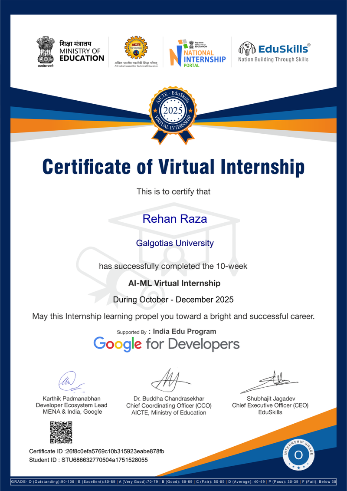
  </a>
  <br /><sub>🔍 <i>Click image to view high-resolution certificate</i></sub>
</div>

| Attribute | Details |
| :--- | :--- |
| **Issuing Organization** | Google for Developers (India Edu Program) & AICTE EduSkills |
| **Credential Type** | `Virtual Internship Certificate` |
| **Completion / Issue Date** | October - December 2025 |
| **Credential ID** | `26f8c0efa5769c10b315923eabe878fb` |
| **Verification URL** | *Not Available* |
| **Grade Awarded** | **O (Outstanding)** |
| **Signatory / Authority** | Karthik Padmanabhan (Developer Ecosystem Lead MENA & India, Google) |
| **Direct Certificate File** | [📂 Open File: `Google-Developers-AI-ML-Virtual-Internship.pdf`](Artificial-Intelligence/Google-Developers-AI-ML-Virtual-Internship.pdf) |

**📖 About the Certification:**  
Intensive 10-week technical internship supported by Google for Developers India Edu Program and certified by AICTE EduSkills. Awarded with top-tier grade 'O' (Outstanding).

**🧠 Key Concepts Learned:**  
Building predictive neural networks, implementing deep learning architectures, preprocessing multimedia data for AI tasks, and leveraging Google developer toolkits for machine learning.

**🎯 Technical Skills Gained:**  
`Machine Learning Architectures`, `Deep Learning Foundations`, `Computer Vision & NLP Concepts`, `TensorFlow Workflows`, `Model Training & Evaluation`

**🛠️ Tools & Technologies:**  
`Google for Developers Ecosystem`, `TensorFlow`, `Keras`, `Python`

**🚀 Practical Learning Outcomes:**  
Demonstrated practical capability to design, train, and validate AI models following Google developer best practices, backed by national-level internship credentials.

<div align='right'><a href='#-table-of-contents'>⬆ Back to Top</a></div>

---

### 3. HackerRank Orchestrate - AI Agent Development & Deployment

<div align="center">
  <a href="Artificial-Intelligence/HackerRank-Orchestrate-AI-Agent-Achievement.png" target="_blank">
    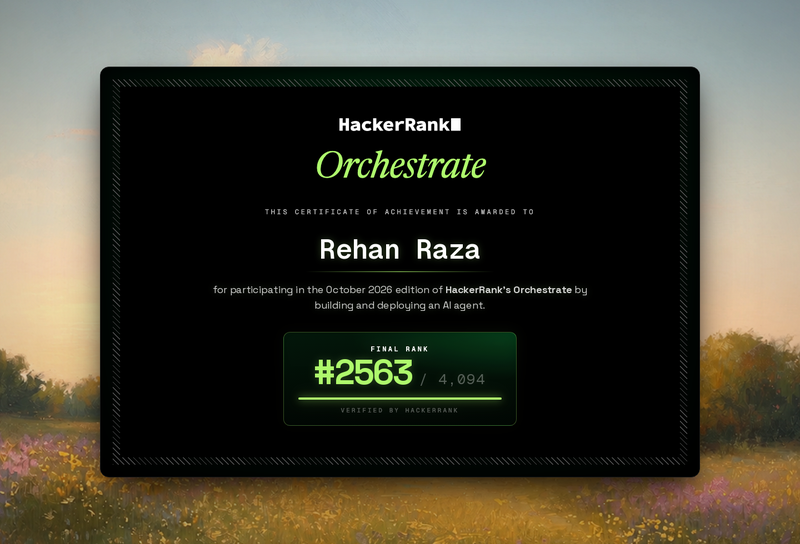
  </a>
  <br /><sub>🔍 <i>Click image to view high-resolution certificate</i></sub>
</div>

| Attribute | Details |
| :--- | :--- |
| **Issuing Organization** | HackerRank |
| **Credential Type** | `Competition / Hackathon Certificate of Achievement` |
| **Completion / Issue Date** | October 2026 |
| **Credential ID** | `Rank #2563 / 4,094` |
| **Verification Status** | `Verified by HackerRank` |
| **Direct Certificate File** | [📂 Open File: `HackerRank-Orchestrate-AI-Agent-Achievement.png`](Artificial-Intelligence/HackerRank-Orchestrate-AI-Agent-Achievement.png) |

**📖 About the Certification:**  
National competitive challenge certificate awarded for participating in HackerRank's Orchestrate (October 2026 edition), designing, building, and deploying a functional AI agent, finishing ranked #2563 out of 4,094 engineers.

**🧠 Key Concepts Learned:**  
Architecting autonomous agent decision loops, integrating external API tools with language models, debugging autonomous execution steps, and deploying agentic workflows.

**🎯 Technical Skills Gained:**  
`Autonomous AI Agents`, `LLM Orchestration`, `Prompt Engineering`, `Tool Calling & Function Execution`, `AI Agent Deployment`

**🛠️ Tools & Technologies:**  
`HackerRank Platform`, `LLM APIs`, `Python`, `Agentic Frameworks`

**🚀 Practical Learning Outcomes:**  
Demonstrated competitive problem-solving skills in building state-of-the-art AI agents under timed hackathon evaluation standards.

<div align='right'><a href='#-table-of-contents'>⬆ Back to Top</a></div>

---

### 4. Artificial Intelligence Intern (1-Month Internship)

<div align="center">
  <a href="Artificial-Intelligence/Codec-Technologies-AI-Internship-Certificate.pdf" target="_blank">
    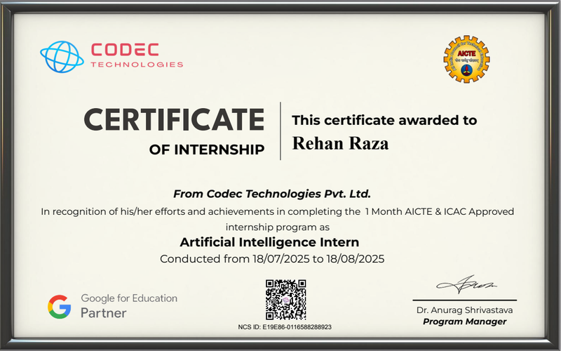
  </a>
  <br /><sub>🔍 <i>Click image to view high-resolution certificate</i></sub>
</div>

| Attribute | Details |
| :--- | :--- |
| **Issuing Organization** | Codec Technologies Pvt. Ltd. (Google for Education Partner) |
| **Credential Type** | `Internship Certificate` |
| **Completion / Issue Date** | 18/07/2025 to 18/08/2025 |
| **Credential ID** | `NCS ID: E19E86-0116588288923` |
| **Verification URL** | *Not Available* |
| **Signatory / Authority** | Dr. Anurag Shrivastava (Program Manager) |
| **Direct Certificate File** | [📂 Open File: `Codec-Technologies-AI-Internship-Certificate.pdf`](Artificial-Intelligence/Codec-Technologies-AI-Internship-Certificate.pdf) |

**📖 About the Certification:**  
AICTE & ICAC approved 1-month professional internship as an Artificial Intelligence Intern at Codec Technologies, an official Google for Education Partner.

**🧠 Key Concepts Learned:**  
Applying machine learning and AI principles to business use cases, collaborating with engineering teams, refactoring algorithmic code, and testing model outputs on real-world datasets.

**🎯 Technical Skills Gained:**  
`Applied Artificial Intelligence`, `Predictive Modeling`, `Algorithm Implementation`, `Collaborative AI Development`, `Industry Standards`

**🛠️ Tools & Technologies:**  
`Python`, `Scikit-Learn`, `Jupyter`, `Git`

**🚀 Practical Learning Outcomes:**  
Acquired valuable corporate internship experience, government registered under NCS ID, demonstrating practical readiness for AI engineering roles.

<div align='right'><a href='#-table-of-contents'>⬆ Back to Top</a></div>

---

### 5. AI Skills Passport for Older Adults

<div align="center">
  <a href="Artificial-Intelligence/EY-Microsoft-AI-Skills-Passport.pdf" target="_blank">
    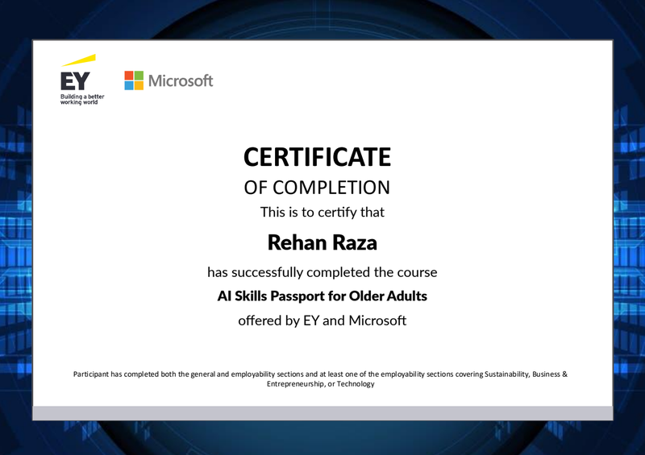
  </a>
  <br /><sub>🔍 <i>Click image to view high-resolution certificate</i></sub>
</div>

| Attribute | Details |
| :--- | :--- |
| **Issuing Organization** | EY (Ernst & Young) & Microsoft |
| **Credential Type** | `Course Completion Certificate` |
| **Completion / Issue Date** | 2026 |
| **Credential ID** | `280997_370_ys0jj` |
| **Verification URL** | *Not Available* |
| **Direct Certificate File** | [📂 Open File: `EY-Microsoft-AI-Skills-Passport.pdf`](Artificial-Intelligence/EY-Microsoft-AI-Skills-Passport.pdf) |

**📖 About the Certification:**  
Collaborative educational initiative by Ernst & Young and Microsoft designed to advance AI literacy, digital inclusion, and applied AI assistive technologies.

**🧠 Key Concepts Learned:**  
Evaluating human-centered AI interfaces, designing accessible digital solutions powered by AI, and leveraging generative AI tools to assist diverse demographics.

**🎯 Technical Skills Gained:**  
`AI Literacy`, `Generative AI Fundamentals`, `Digital Accessibility`, `Assistive AI Technology`, `Inclusive Design`

**🛠️ Tools & Technologies:**  
`Microsoft AI Tools`, `Copilot Concepts`

**🚀 Practical Learning Outcomes:**  
Gained specialized insight into accessible software design and responsible AI user experience practices from leading global technology firms.

<div align='right'><a href='#-table-of-contents'>⬆ Back to Top</a></div>

---

## 💻 Programming, Data Structures & Algorithms

> *Algorithm optimization, problem solving (250+ problems), Java, Python, C, and role assessments.*

### 1. Alpha (DSA with Java)

<div align="center">
  <a href="Programming-DSA/Apna-College-Alpha-DSA-with-Java.pdf" target="_blank">
    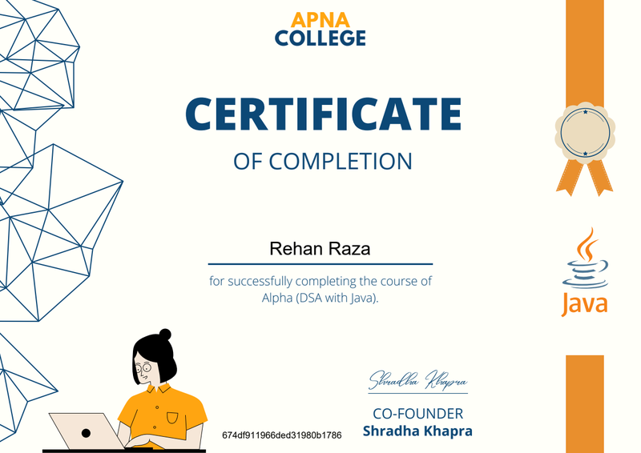
  </a>
  <br /><sub>🔍 <i>Click image to view high-resolution certificate</i></sub>
</div>

| Attribute | Details |
| :--- | :--- |
| **Issuing Organization** | Apna College |
| **Credential Type** | `Course Completion Certificate` |
| **Completion / Issue Date** | 2024 |
| **Credential ID** | `674df911966ded31980b1786` |
| **Verification URL** | *Not Available* |
| **Signatory / Authority** | Shradha Khapra (Co-Founder, Apna College) |
| **Direct Certificate File** | [📂 Open File: `Apna-College-Alpha-DSA-with-Java.pdf`](Programming-DSA/Apna-College-Alpha-DSA-with-Java.pdf) |

**📖 About the Certification:**  
Comprehensive flagship Data Structures & Algorithms bootcamp in Java taught by Shradha Khapra, covering foundational programming to advanced algorithmic design.

**🧠 Key Concepts Learned:**  
Mastery of linear data structures (Arrays, Linked Lists, Stacks, Queues) and non-linear structures (Binary Trees, BSTs, Heaps, Graphs), alongside advanced algorithm techniques (Greedy, Divide & Conquer, Backtracking, DP).

**🎯 Technical Skills Gained:**  
`Data Structures & Algorithms`, `Time & Space Complexity`, `Recursion & Backtracking`, `Trees & Graphs`, `Dynamic Programming`, `Java OOP`

**🛠️ Tools & Technologies:**  
`Java`, `IntelliJ IDEA / Eclipse`, `Git`

**🚀 Practical Learning Outcomes:**  
High proficiency in algorithmic problem solving, rigorous code optimization, and technical interview readiness for software engineering roles.

<div align='right'><a href='#-table-of-contents'>⬆ Back to Top</a></div>

---

### 2. GU Prerequisite (DS using Java) - R1UC303B

<div align="center">
  <a href="Programming-DSA/GUVI-Data-Structures-using-Java.png" target="_blank">
    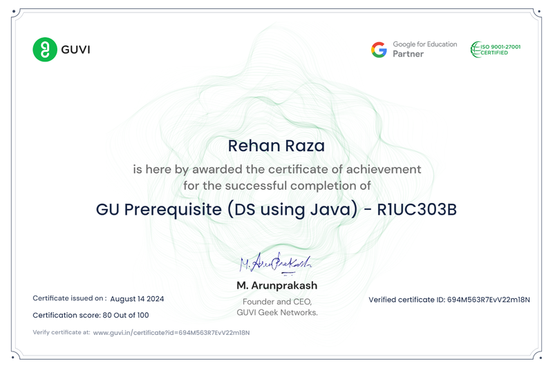
  </a>
  <br /><sub>🔍 <i>Click image to view high-resolution certificate</i></sub>
</div>

| Attribute | Details |
| :--- | :--- |
| **Issuing Organization** | GUVI (Google for Education Partner) |
| **Credential Type** | `Course Completion Certificate` |
| **Completion / Issue Date** | August 14, 2024 |
| **Credential ID** | `694M563R7EvV22m18N` |
| **Verification URL** | [🔗 Verify Credential Online](https://www.guvi.in/certificate?id=694M563R7EvV22m18N) |
| **Performance / Score** | **80 Out of 100** |
| **Direct Certificate File** | [📂 Open File: `GUVI-Data-Structures-using-Java.png`](Programming-DSA/GUVI-Data-Structures-using-Java.png) |

**📖 About the Certification:**  
Rigorous academic prerequisite certification focusing on core data structures implemented in Java, achieving a high score of 80/100.

**🧠 Key Concepts Learned:**  
Hands-on implementation of custom data structures, practical application of Java Generics and Collections, and performance benchmarking across various algorithmic implementations.

**🎯 Technical Skills Gained:**  
`Java Collections Framework`, `Data Structure Implementation`, `Memory Management`, `Searching & Sorting`, `Algorithmic Analysis`

**🛠️ Tools & Technologies:**  
`Java`, `GUVI IDE`

**🚀 Practical Learning Outcomes:**  
Demonstrated mastery of core data structure fundamentals in Java with verified institutional grading.

<div align='right'><a href='#-table-of-contents'>⬆ Back to Top</a></div>

---

### 3. Java for Beginners

<div align="center">
  <a href="Programming-DSA/GUVI-Java-for-Beginners.png" target="_blank">
    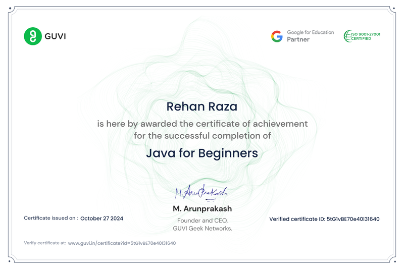
  </a>
  <br /><sub>🔍 <i>Click image to view high-resolution certificate</i></sub>
</div>

| Attribute | Details |
| :--- | :--- |
| **Issuing Organization** | GUVI (Google for Education Partner) |
| **Credential Type** | `Course Completion Certificate` |
| **Completion / Issue Date** | October 27, 2024 |
| **Credential ID** | `5tG1vBE70e40l31640` |
| **Verification URL** | [🔗 Verify Credential Online](https://www.guvi.in/certificate?id=5tG1vBE70e40l31640) |
| **Direct Certificate File** | [📂 Open File: `GUVI-Java-for-Beginners.png`](Programming-DSA/GUVI-Java-for-Beginners.png) |

**📖 About the Certification:**  
Foundational programming certification exploring object-oriented design and syntax in Java.

**🧠 Key Concepts Learned:**  
Encapsulation, inheritance, polymorphism, abstraction, interface design, method overloading/overriding, and robust exception handling in Java.

**🎯 Technical Skills Gained:**  
`Java Syntax`, `Object-Oriented Programming (OOP)`, `Inheritance & Polymorphism`, `Exception Handling`, `Basic I/O`

**🛠️ Tools & Technologies:**  
`Java Development Kit (JDK)`, `GUVI Platform`

**🚀 Practical Learning Outcomes:**  
Strong foundation in object-oriented programming principles necessary for backend engineering and enterprise software development.

<div align='right'><a href='#-table-of-contents'>⬆ Back to Top</a></div>

---

### 4. Practice Java

<div align="center">
  <a href="Programming-DSA/CodeChef-Practice-Java.pdf" target="_blank">
    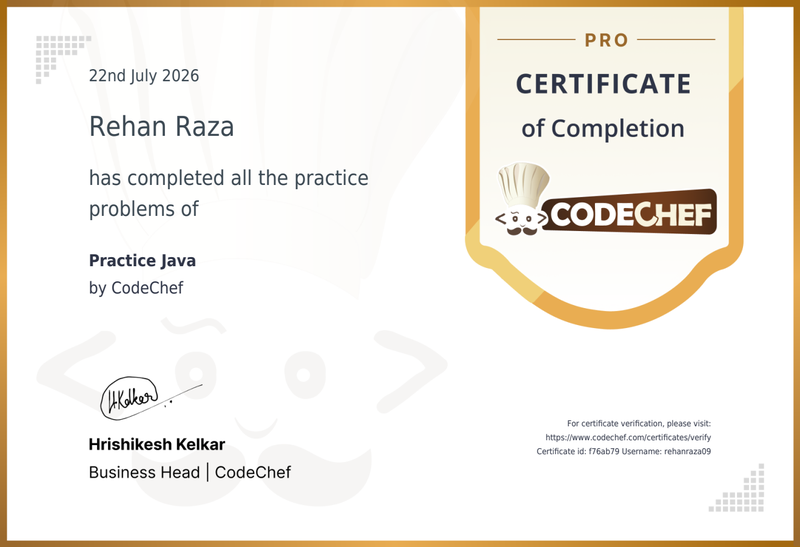
  </a>
  <br /><sub>🔍 <i>Click image to view high-resolution certificate</i></sub>
</div>

| Attribute | Details |
| :--- | :--- |
| **Issuing Organization** | CodeChef |
| **Credential Type** | `Practice Track Completion Certificate` |
| **Completion / Issue Date** | July 22, 2026 |
| **Credential ID** | `f76ab79` |
| **Verification URL** | [🔗 Verify Credential Online](https://www.codechef.com/certificates/verify) |
| **Direct Certificate File** | [📂 Open File: `CodeChef-Practice-Java.pdf`](Programming-DSA/CodeChef-Practice-Java.pdf) |

**📖 About the Certification:**  
Certificate awarded for successfully solving and passing all benchmark problem sets in the Practice Java track on CodeChef.

**🧠 Key Concepts Learned:**  
Solving timed algorithmic challenges, implementing edge-case handling, and writing clean, memory-efficient Java solutions for competitive tests.

**🎯 Technical Skills Gained:**  
`Competitive Programming`, `Java Problem Solving`, `Edge Case Handling`, `Time Complexity Optimization`

**🛠️ Tools & Technologies:**  
`CodeChef Competitive Platform`, `Java`

**🚀 Practical Learning Outcomes:**  
Enhanced practical coding speed and accurate bug-free implementation of data manipulation tasks in Java.

<div align='right'><a href='#-table-of-contents'>⬆ Back to Top</a></div>

---

### 5. Problem Solver Silver Badge (250 Problems Solved)

<div align="center">
  <a href="Programming-DSA/CodeChef-Problem-Solver-Silver-Badge-250.png" target="_blank">
    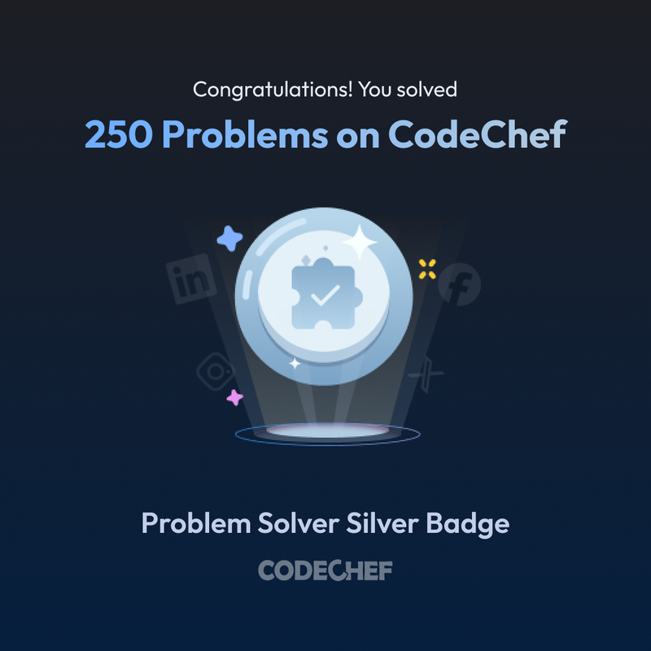
  </a>
  <br /><sub>🔍 <i>Click image to view high-resolution certificate</i></sub>
</div>

| Attribute | Details |
| :--- | :--- |
| **Issuing Organization** | CodeChef |
| **Credential Type** | `Achievement Badge` |
| **Completion / Issue Date** | 2026 |
| **Credential ID** | *Not Available* |
| **Verification URL** | [🔗 Verify Credential Online](https://www.codechef.com/users/rehanraza09) |
| **Direct Certificate File** | [📂 Open File: `CodeChef-Problem-Solver-Silver-Badge-250.png`](Programming-DSA/CodeChef-Problem-Solver-Silver-Badge-250.png) |

**📖 About the Certification:**  
Official Problem Solver Silver Badge awarded by CodeChef commemorating solving over 250 coding problems on the platform.

**🧠 Key Concepts Learned:**  
Consistent practice across diverse computational problem domains including strings, arrays, number theory, and search optimizations.

**🎯 Technical Skills Gained:**  
`Problem Solving`, `Competitive Programming`, `Mathematical Logic`, `Algorithmic Analysis`

**🛠️ Tools & Technologies:**  
`CodeChef Platform`

**🚀 Practical Learning Outcomes:**  
Demonstrated persistent commitment to algorithmic problem solving, active competitive coding discipline, and computational logic.

<div align='right'><a href='#-table-of-contents'>⬆ Back to Top</a></div>

---

### 6. C Programming for Beginners

<div align="center">
  <a href="Programming-DSA/GUVI-C-Programming-for-Beginners.png" target="_blank">
    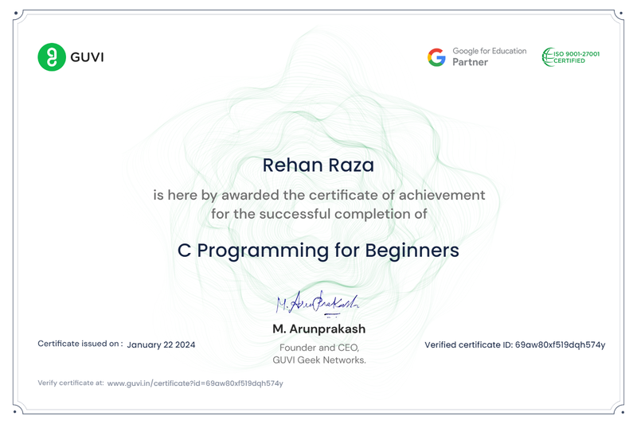
  </a>
  <br /><sub>🔍 <i>Click image to view high-resolution certificate</i></sub>
</div>

| Attribute | Details |
| :--- | :--- |
| **Issuing Organization** | GUVI (Google for Education Partner) |
| **Credential Type** | `Course Completion Certificate` |
| **Completion / Issue Date** | January 22, 2024 |
| **Credential ID** | `69aw80xf519dqh574y` |
| **Verification URL** | [🔗 Verify Credential Online](https://www.guvi.in/certificate?id=69aw80xf519dqh574y) |
| **Direct Certificate File** | [📂 Open File: `GUVI-C-Programming-for-Beginners.png`](Programming-DSA/GUVI-C-Programming-for-Beginners.png) |

**📖 About the Certification:**  
Fundamental computer science certification covering structured procedural programming in C, low-level memory addressing, and pointer arithmetic.

**🧠 Key Concepts Learned:**  
Memory allocation (malloc, calloc, realloc, free), pointers, structs, file manipulation, and compiling system-level C code.

**🎯 Technical Skills Gained:**  
`Low-Level Programming`, `Pointers & Memory Addresses`, `Dynamic Memory Allocation`, `Structures & Unions`, `Bitwise Operations`

**🛠️ Tools & Technologies:**  
`GCC Compiler`, `C`

**🚀 Practical Learning Outcomes:**  
In-depth understanding of computer memory architecture and fundamental low-level execution models.

<div align='right'><a href='#-table-of-contents'>⬆ Back to Top</a></div>

---

### 7. Python Programming

<div align="center">
  <a href="Programming-DSA/GUVI-Python-Foundations.png" target="_blank">
    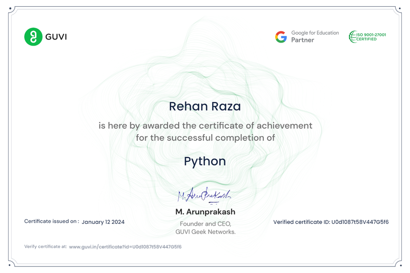
  </a>
  <br /><sub>🔍 <i>Click image to view high-resolution certificate</i></sub>
</div>

| Attribute | Details |
| :--- | :--- |
| **Issuing Organization** | GUVI (Google for Education Partner) |
| **Credential Type** | `Course Completion Certificate` |
| **Completion / Issue Date** | January 12, 2024 |
| **Credential ID** | `U0d1087t58V447G5f6` |
| **Verification URL** | [🔗 Verify Credential Online](https://www.guvi.in/certificate?id=U0d1087t58V447G5f6) |
| **Direct Certificate File** | [📂 Open File: `GUVI-Python-Foundations.png`](Programming-DSA/GUVI-Python-Foundations.png) |

**📖 About the Certification:**  
Accredited certification establishing core proficiency in Python syntax, standard library modules, and programmatic logic.

**🧠 Key Concepts Learned:**  
Writing reusable Python modules, handling data input/output, and implementing procedural and functional patterns in Python.

**🎯 Technical Skills Gained:**  
`Python Syntax`, `Functional Programming`, `Data Structures`, `Modular Programming`

**🛠️ Tools & Technologies:**  
`Python 3`, `GUVI IDE`

**🚀 Practical Learning Outcomes:**  
Firm grasp of Python development essentials required for advanced data science and automation.

<div align='right'><a href='#-table-of-contents'>⬆ Back to Top</a></div>

---

### 8. 100 Days of Python Beginner

<div align="center">
  <a href="Programming-DSA/GUVI-100-Days-Python-Beginner.png" target="_blank">
    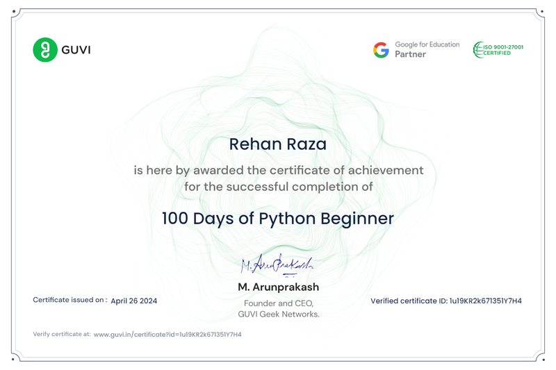
  </a>
  <br /><sub>🔍 <i>Click image to view high-resolution certificate</i></sub>
</div>

| Attribute | Details |
| :--- | :--- |
| **Issuing Organization** | GUVI (Google for Education Partner) |
| **Credential Type** | `Course Completion Certificate` |
| **Completion / Issue Date** | April 26, 2024 |
| **Credential ID** | `1u19KR2k671351Y7H4` |
| **Verification URL** | [🔗 Verify Credential Online](https://www.guvi.in/certificate?id=1u19KR2k671351Y7H4) |
| **Direct Certificate File** | [📂 Open File: `GUVI-100-Days-Python-Beginner.png`](Programming-DSA/GUVI-100-Days-Python-Beginner.png) |

**📖 About the Certification:**  
Stage 1 of the rigorous 100 Days of Python coding journey focusing on syntax mastery, problem decomposition, and daily coding discipline.

**🧠 Key Concepts Learned:**  
Building iterative programs, mastering flow control, writing modular functions, and solving daily algorithmic challenges.

**🎯 Technical Skills Gained:**  
`Variables & Data Types`, `Conditionals & Loops`, `Functions & Scope`, `String Manipulation`

**🛠️ Tools & Technologies:**  
`Python 3`

**🚀 Practical Learning Outcomes:**  
Established solid coding fluency and disciplined daily programming habits.

<div align='right'><a href='#-table-of-contents'>⬆ Back to Top</a></div>

---

### 9. 100 Days of Python Intermediate

<div align="center">
  <a href="Programming-DSA/GUVI-100-Days-Python-Intermediate.png" target="_blank">
    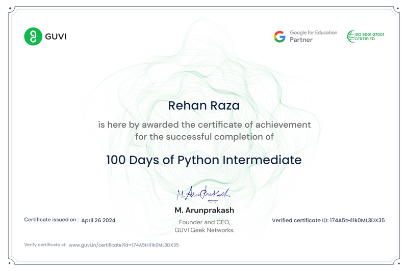
  </a>
  <br /><sub>🔍 <i>Click image to view high-resolution certificate</i></sub>
</div>

| Attribute | Details |
| :--- | :--- |
| **Issuing Organization** | GUVI (Google for Education Partner) |
| **Credential Type** | `Course Completion Certificate` |
| **Completion / Issue Date** | April 26, 2024 |
| **Credential ID** | `174A5tH11k0ML3DX35` |
| **Verification URL** | [🔗 Verify Credential Online](https://www.guvi.in/certificate?id=174A5tH11k0ML3DX35) |
| **Direct Certificate File** | [📂 Open File: `GUVI-100-Days-Python-Intermediate.png`](Programming-DSA/GUVI-100-Days-Python-Intermediate.png) |

**📖 About the Certification:**  
Stage 2 of the 100 Days of Python track covering intermediate architectural concepts, classes, objects, and modular design.

**🧠 Key Concepts Learned:**  
Designing Python classes, inheritance, encapsulation, reading/writing JSON and CSV files, and graceful error recovery.

**🎯 Technical Skills Gained:**  
`Object-Oriented Python`, `List Comprehensions`, `Error & Exception Handling`, `File Management`

**🛠️ Tools & Technologies:**  
`Python 3`

**🚀 Practical Learning Outcomes:**  
Ability to write clean, modular, and maintainable object-oriented Python software.

<div align='right'><a href='#-table-of-contents'>⬆ Back to Top</a></div>

---

### 10. 100 Days of Python Advance

<div align="center">
  <a href="Programming-DSA/GUVI-100-Days-Python-Advance.png" target="_blank">
    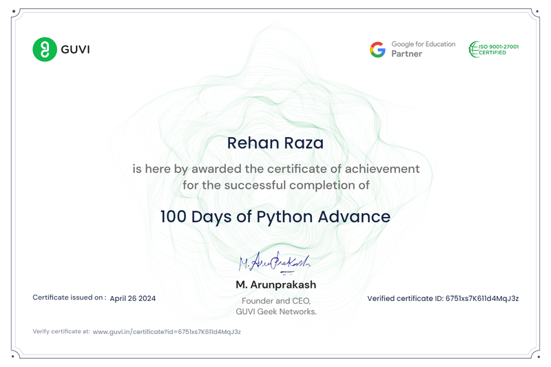
  </a>
  <br /><sub>🔍 <i>Click image to view high-resolution certificate</i></sub>
</div>

| Attribute | Details |
| :--- | :--- |
| **Issuing Organization** | GUVI (Google for Education Partner) |
| **Credential Type** | `Course Completion Certificate` |
| **Completion / Issue Date** | April 26, 2024 |
| **Credential ID** | `6751xs7K611d4MqJ3z` |
| **Verification URL** | [🔗 Verify Credential Online](https://www.guvi.in/certificate?id=6751xs7K611d4MqJ3z) |
| **Direct Certificate File** | [📂 Open File: `GUVI-100-Days-Python-Advance.png`](Programming-DSA/GUVI-100-Days-Python-Advance.png) |

**📖 About the Certification:**  
Stage 3 of the 100 Days of Python series diving into Python internal mechanics, functional constructs, and advanced programming patterns.

**🧠 Key Concepts Learned:**  
Writing custom decorators, memory-efficient generators, regular expressions for text mining, and advanced context managers.

**🎯 Technical Skills Gained:**  
`Decorators & Generators`, `Concurrency Basics`, `Advanced Iterators`, `RegEx & Parsing`

**🛠️ Tools & Technologies:**  
`Python 3`

**🚀 Practical Learning Outcomes:**  
Deep understanding of advanced Python idioms, enabling high-performance and expressive software design.

<div align='right'><a href='#-table-of-contents'>⬆ Back to Top</a></div>

---

### 11. 100 Days of Python Expert

<div align="center">
  <a href="Programming-DSA/GUVI-100-Days-Python-Expert.png" target="_blank">
    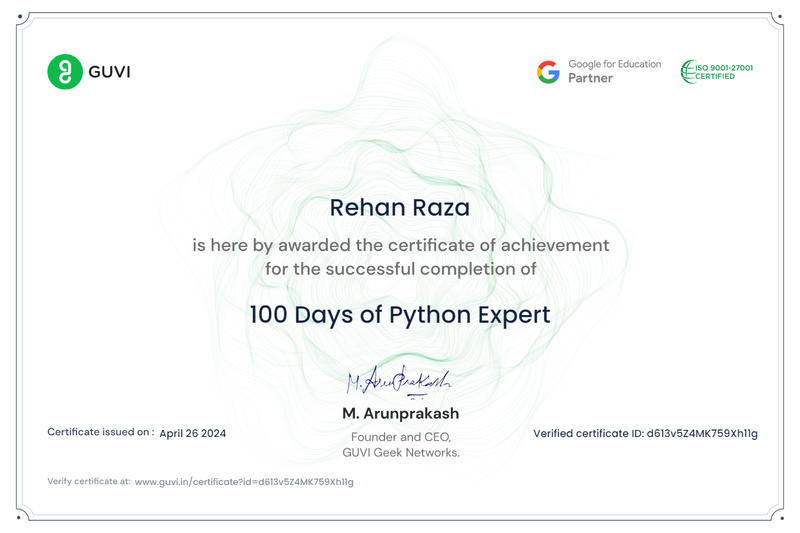
  </a>
  <br /><sub>🔍 <i>Click image to view high-resolution certificate</i></sub>
</div>

| Attribute | Details |
| :--- | :--- |
| **Issuing Organization** | GUVI (Google for Education Partner) |
| **Credential Type** | `Course Completion Certificate` |
| **Completion / Issue Date** | April 26, 2024 |
| **Credential ID** | `d613v5Z4MK759Xh11g` |
| **Verification URL** | [🔗 Verify Credential Online](https://www.guvi.in/certificate?id=d613v5Z4MK759Xh11g) |
| **Direct Certificate File** | [📂 Open File: `GUVI-100-Days-Python-Expert.png`](Programming-DSA/GUVI-100-Days-Python-Expert.png) |

**📖 About the Certification:**  
Culminating expert stage of the 100 Days of Python curriculum covering system-level Python architecture, metaprogramming, and performance profiling.

**🧠 Key Concepts Learned:**  
Metaclasses, dunder methods, profiling code execution times, memory footprint reduction, and packaging reusable Python libraries.

**🎯 Technical Skills Gained:**  
`Metaprogramming`, `Memory Optimization`, `Package Development`, `Design Patterns`

**🛠️ Tools & Technologies:**  
`Python 3`

**🚀 Practical Learning Outcomes:**  
Attained mastery of Python programming techniques suited for enterprise software engineering and high-throughput pipelines.

<div align='right'><a href='#-table-of-contents'>⬆ Back to Top</a></div>

---

### 12. Python Zero to Hero

<div align="center">
  <a href="Programming-DSA/GUVI-Python-Zero-to-Hero.png" target="_blank">
    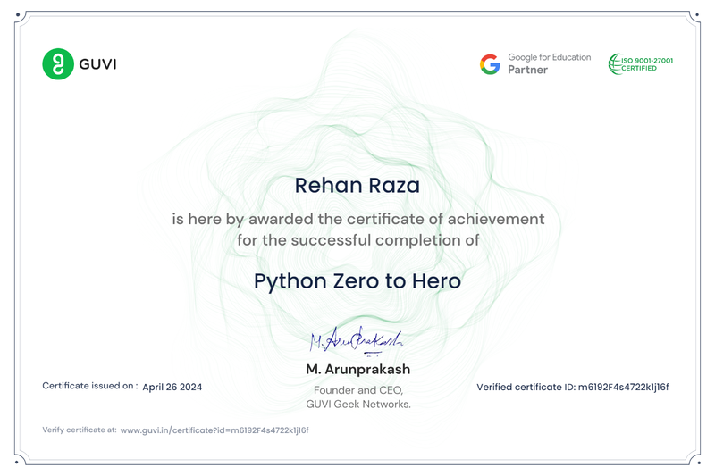
  </a>
  <br /><sub>🔍 <i>Click image to view high-resolution certificate</i></sub>
</div>

| Attribute | Details |
| :--- | :--- |
| **Issuing Organization** | GUVI (Google for Education Partner) |
| **Credential Type** | `Comprehensive Track Certificate` |
| **Completion / Issue Date** | April 26, 2024 |
| **Credential ID** | `m6192F4s4722k1j16f` |
| **Verification URL** | [🔗 Verify Credential Online](https://www.guvi.in/certificate?id=m6192F4s4722k1j16f) |
| **Direct Certificate File** | [📂 Open File: `GUVI-Python-Zero-to-Hero.png`](Programming-DSA/GUVI-Python-Zero-to-Hero.png) |

**📖 About the Certification:**  
Comprehensive milestone certificate validating the end-to-end completion of the Python Zero to Hero learning roadmap on GUVI.

**🧠 Key Concepts Learned:**  
Synthesizing fundamentals, data structures, object-oriented design, and practical scripting into cohesive real-world mini-projects.

**🎯 Technical Skills Gained:**  
`Full Python Lifecycle`, `Scripting & Automation`, `Mini-Projects`, `Best Coding Practices`

**🛠️ Tools & Technologies:**  
`Python 3`

**🚀 Practical Learning Outcomes:**  
Demonstrated complete mastery of the Python programming language from initial concepts to advanced software development.

<div align='right'><a href='#-table-of-contents'>⬆ Back to Top</a></div>

---

### 13. Software Engineer Intern Role Certification

<div align="center">
  <a href="Programming-DSA/HackerRank-Software-Engineer-Intern.pdf" target="_blank">
    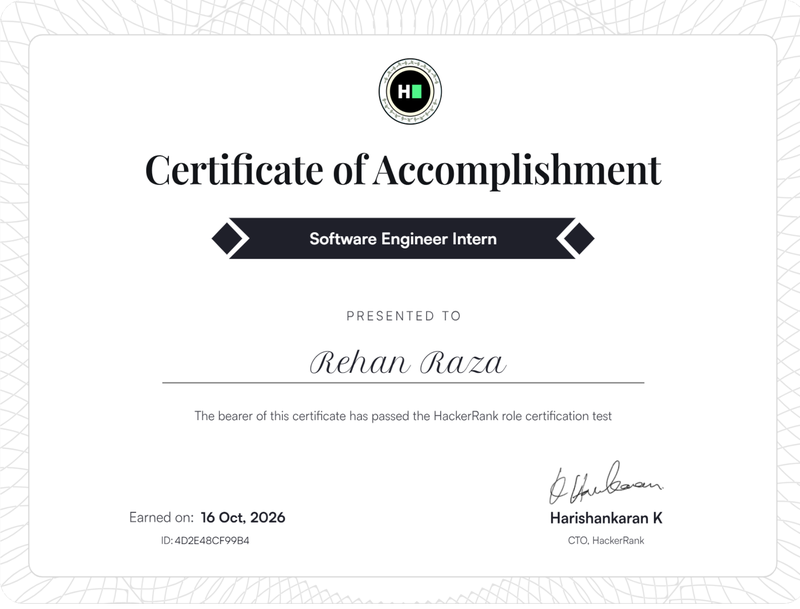
  </a>
  <br /><sub>🔍 <i>Click image to view high-resolution certificate</i></sub>
</div>

| Attribute | Details |
| :--- | :--- |
| **Issuing Organization** | HackerRank |
| **Credential Type** | `Role Certification Assessment` |
| **Completion / Issue Date** | October 16, 2026 |
| **Credential ID** | `4D2E48CF99B4` |
| **Verification URL** | [🔗 Verify Credential Online](https://www.hackerrank.com/certificates/4D2E48CF99B4) |
| **Signatory / Authority** | Harishankaran K (CTO, HackerRank) |
| **Direct Certificate File** | [📂 Open File: `HackerRank-Software-Engineer-Intern.pdf`](Programming-DSA/HackerRank-Software-Engineer-Intern.pdf) |

**📖 About the Certification:**  
Standardized industry skill assessment certification validating that the bearer has passed the rigorous HackerRank Software Engineer Intern role certification test.

**🧠 Key Concepts Learned:**  
Solving timed algorithmic challenges under strict test case criteria, validating boundary conditions, and writing optimized code.

**🎯 Technical Skills Gained:**  
`Problem Solving`, `Data Structures`, `Algorithms`, `Software Engineering Principles`, `Code Quality`

**🛠️ Tools & Technologies:**  
`HackerRank Assessment Environment`

**🚀 Practical Learning Outcomes:**  
Industry-verified credential proving engineering readiness for software engineering intern roles at top technology companies.

<div align='right'><a href='#-table-of-contents'>⬆ Back to Top</a></div>

---

## 🌐 Full Stack & Web Engineering

> *Modern MERN stack (MongoDB, Express, React, Node.js), REST APIs, and responsive architectures.*

### 1. Full Stack Development using MERN

<div align="center">
  <a href="Full-Stack-Development/CodeChef-Full-Stack-Development-MERN.pdf" target="_blank">
    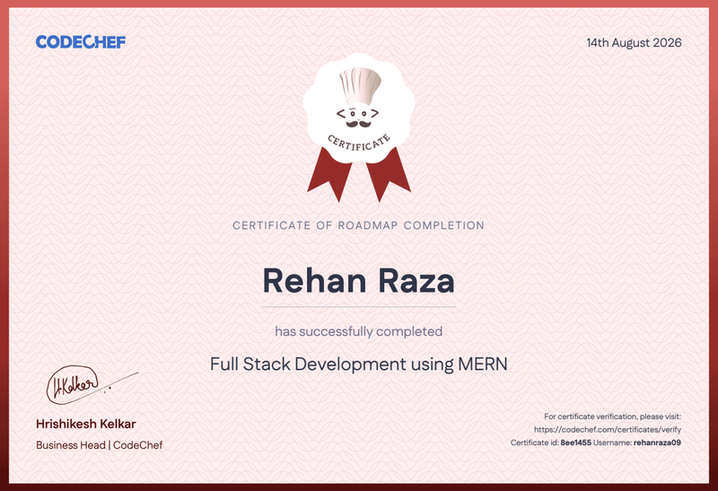
  </a>
  <br /><sub>🔍 <i>Click image to view high-resolution certificate</i></sub>
</div>

| Attribute | Details |
| :--- | :--- |
| **Issuing Organization** | CodeChef |
| **Credential Type** | `Roadmap Completion Certificate` |
| **Completion / Issue Date** | August 14, 2026 |
| **Credential ID** | `8ee1455` |
| **Verification URL** | [🔗 Verify Credential Online](https://codechef.com/certificates/verify) |
| **Direct Certificate File** | [📂 Open File: `CodeChef-Full-Stack-Development-MERN.pdf`](Full-Stack-Development/CodeChef-Full-Stack-Development-MERN.pdf) |

**📖 About the Certification:**  
Complete roadmap certificate mastering full stack web application development using the modern MERN (MongoDB, Express, React, Node.js) technology stack.

**🧠 Key Concepts Learned:**  
Building single page applications with React, designing scalable backend servers with Express and Node.js, and modeling document databases in MongoDB.

**🎯 Technical Skills Gained:**  
`MongoDB`, `Express.js`, `React.js`, `Node.js`, `RESTful APIs`, `Full Stack Architecture`

**🛠️ Tools & Technologies:**  
`MERN Stack`, `Postman`, `NPM`, `VS Code`

**🚀 Practical Learning Outcomes:**  
Capacity to design, develop, and deploy full stack web applications with seamless frontend-backend data synchronization.

<div align='right'><a href='#-table-of-contents'>⬆ Back to Top</a></div>

---

### 2. Full Stack Projects using MERN

<div align="center">
  <a href="Full-Stack-Development/CodeChef-Full-Stack-Projects-MERN.pdf" target="_blank">
    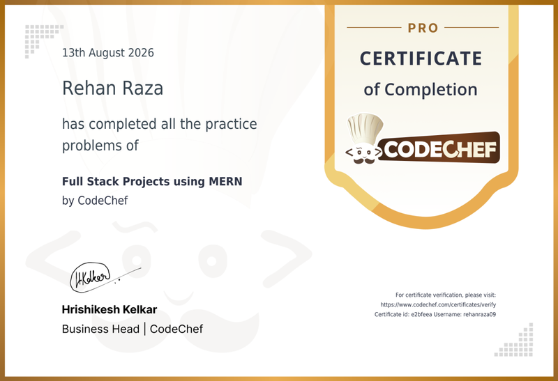
  </a>
  <br /><sub>🔍 <i>Click image to view high-resolution certificate</i></sub>
</div>

| Attribute | Details |
| :--- | :--- |
| **Issuing Organization** | CodeChef |
| **Credential Type** | `Project Completion Certificate` |
| **Completion / Issue Date** | August 13, 2026 |
| **Credential ID** | `e2bfeea` |
| **Verification URL** | [🔗 Verify Credential Online](https://codechef.com/certificates/verify) |
| **Direct Certificate File** | [📂 Open File: `CodeChef-Full-Stack-Projects-MERN.pdf`](Full-Stack-Development/CodeChef-Full-Stack-Projects-MERN.pdf) |

**📖 About the Certification:**  
Hands-on project track focused on implementing real-world production-grade full stack applications with the MERN stack.

**🧠 Key Concepts Learned:**  
Implementing secure JWT-based user authentication, designing complex schema models, handling asynchronous state, and structuring modular codebases.

**🎯 Technical Skills Gained:**  
`Project Architecture`, `State Management`, `Authentication & Authorization`, `CRUD Operations`, `API Integration`

**🛠️ Tools & Technologies:**  
`React`, `Node.js`, `MongoDB`, `Express`, `JWT`

**🚀 Practical Learning Outcomes:**  
Demonstrated practical ability to ship end-to-end web projects from database schemas to interactive client interfaces.

<div align='right'><a href='#-table-of-contents'>⬆ Back to Top</a></div>

---

### 3. Learn React JS for Front-end Development

<div align="center">
  <a href="Full-Stack-Development/CodeChef-Learn-React-JS-Frontend-Development.pdf" target="_blank">
    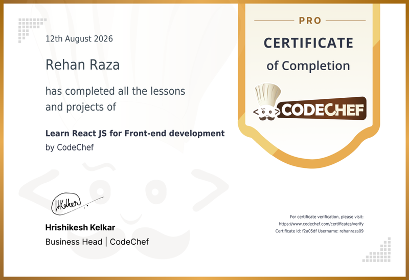
  </a>
  <br /><sub>🔍 <i>Click image to view high-resolution certificate</i></sub>
</div>

| Attribute | Details |
| :--- | :--- |
| **Issuing Organization** | CodeChef |
| **Credential Type** | `Course Completion Certificate` |
| **Completion / Issue Date** | August 12, 2026 |
| **Credential ID** | `f2a05df` |
| **Verification URL** | [🔗 Verify Credential Online](https://codechef.com/certificates/verify) |
| **Direct Certificate File** | [📂 Open File: `CodeChef-Learn-React-JS-Frontend-Development.pdf`](Full-Stack-Development/CodeChef-Learn-React-JS-Frontend-Development.pdf) |

**📖 About the Certification:**  
Comprehensive frontend engineering course covering modern React.js fundamentals, component architecture, and responsive user interface construction.

**🧠 Key Concepts Learned:**  
Building reusable functional components, managing local and shared application states, integrating external REST APIs, and optimizing render performance.

**🎯 Technical Skills Gained:**  
`React Hooks (useState, useEffect)`, `Component Lifecycle`, `Virtual DOM`, `Props & State`, `Event Handling`, `JSX`

**🛠️ Tools & Technologies:**  
`React.js`, `JavaScript (ES6+)`, `HTML5/CSS3`

**🚀 Practical Learning Outcomes:**  
Ability to craft fluid, modern, component-driven web user interfaces with clean architecture.

<div align='right'><a href='#-table-of-contents'>⬆ Back to Top</a></div>

---

### 4. Back-end Development using Node JS

<div align="center">
  <a href="Full-Stack-Development/CodeChef-Backend-Development-Node-JS.pdf" target="_blank">
    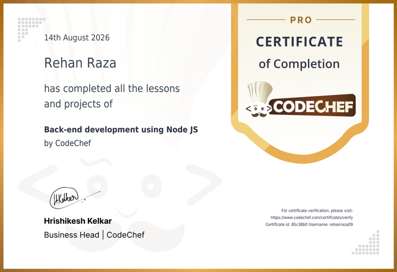
  </a>
  <br /><sub>🔍 <i>Click image to view high-resolution certificate</i></sub>
</div>

| Attribute | Details |
| :--- | :--- |
| **Issuing Organization** | CodeChef |
| **Credential Type** | `Course Completion Certificate` |
| **Completion / Issue Date** | August 14, 2026 |
| **Credential ID** | `85c38b0` |
| **Verification URL** | [🔗 Verify Credential Online](https://codechef.com/certificates/verify) |
| **Direct Certificate File** | [📂 Open File: `CodeChef-Backend-Development-Node-JS.pdf`](Full-Stack-Development/CodeChef-Backend-Development-Node-JS.pdf) |

**📖 About the Certification:**  
Focused backend development curriculum exploring asynchronous server-side programming, microservice communication, and REST API creation with Node.js.

**🧠 Key Concepts Learned:**  
Event loop mechanics, creating robust Express routing pipelines, implementing custom middleware, and handling HTTP requests and status codes.

**🎯 Technical Skills Gained:**  
`Node.js Runtime`, `Express.js Routing`, `Middleware Architecture`, `Asynchronous Programming`, `REST API Development`

**🛠️ Tools & Technologies:**  
`Node.js`, `Express.js`, `NPM`, `Postman`

**🚀 Practical Learning Outcomes:**  
Ability to architect high-performance, asynchronous server applications capable of serving data to web and mobile clients.

<div align='right'><a href='#-table-of-contents'>⬆ Back to Top</a></div>

---

## 🗄️ Database Management Systems

> *Relational database modeling, entity-relationship schemas, and Oracle database design.*

### 1. Database Design

<div align="center">
  <a href="Database-Management/Oracle-Academy-Database-Design.pdf" target="_blank">
    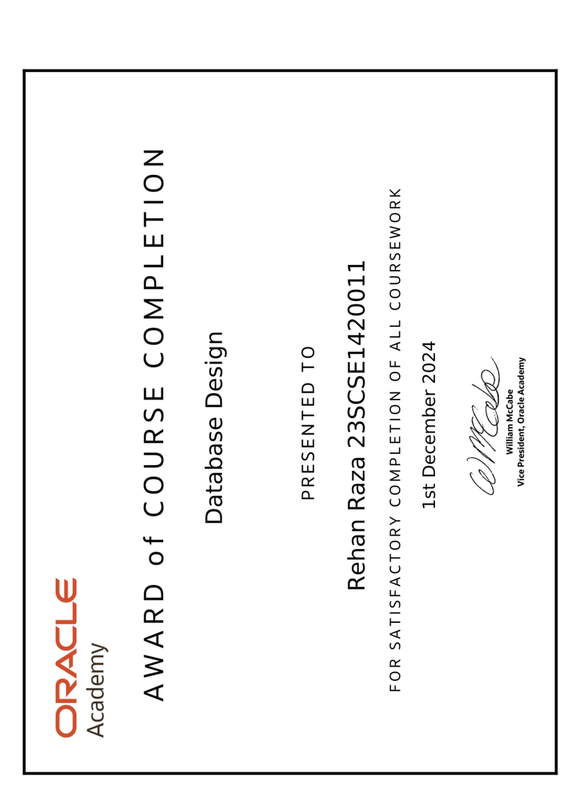
  </a>
  <br /><sub>🔍 <i>Click image to view high-resolution certificate</i></sub>
</div>

| Attribute | Details |
| :--- | :--- |
| **Issuing Organization** | Oracle Academy |
| **Credential Type** | `Award of Course Completion` |
| **Completion / Issue Date** | December 01, 2024 |
| **Credential ID** | `23SCSE1420011` |
| **Verification URL** | *Not Available* |
| **Signatory / Authority** | William McCabe (Vice President, Oracle Academy) |
| **Direct Certificate File** | [📂 Open File: `Oracle-Academy-Database-Design.pdf`](Database-Management/Oracle-Academy-Database-Design.pdf) |

**📖 About the Certification:**  
Prestigious academic course completion award from Oracle Academy validating mastery of enterprise database design, data modeling, and normalization techniques.

**🧠 Key Concepts Learned:**  
Translating complex business requirements into conceptual and physical ER diagrams, defining primary/foreign keys and referential integrity, and eliminating data redundancy through normalization.

**🎯 Technical Skills Gained:**  
`Entity-Relationship (ER) Modeling`, `Database Normalization (1NF, 2NF, 3NF)`, `Relational Schema Design`, `Integrity Constraints`, `Business Rules Mapping`

**🛠️ Tools & Technologies:**  
`Oracle Data Modeler`, `Oracle SQL`

**🚀 Practical Learning Outcomes:**  
Professional ability to architect scalable, resilient relational database architectures ready for enterprise operational workloads.

<div align='right'><a href='#-table-of-contents'>⬆ Back to Top</a></div>

---

## 💼 Industry Job Simulations & Virtual Experience

> *Real-world engineering workflows from global institutions (JPMorgan, Deloitte, Tata, Goldman Sachs).*

### 1. Software Engineering Job Simulation

<div align="center">
  <a href="Virtual-Internships-Job-Simulations/JPMorgan-Software-Engineering-Job-Simulation.pdf" target="_blank">
    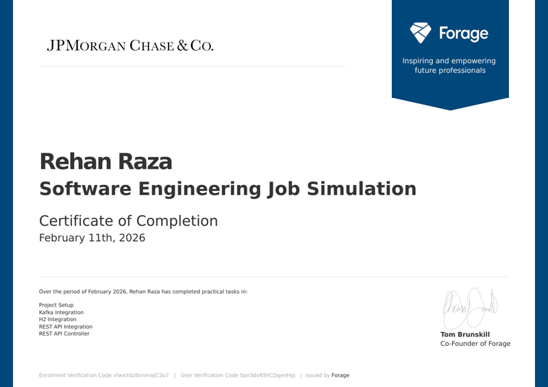
  </a>
  <br /><sub>🔍 <i>Click image to view high-resolution certificate</i></sub>
</div>

| Attribute | Details |
| :--- | :--- |
| **Issuing Organization** | JPMorgan Chase & Co. (via Forage) |
| **Credential Type** | `Virtual Experience / Job Simulation Certificate` |
| **Completion / Issue Date** | February 11, 2026 |
| **Credential ID** | `Enrolment: vtwxYdz8xnmwJC3u7 | User: Spn3dvK9YCDqenHpj` |
| **Verification URL** | [🔗 Verify Credential Online](https://www.theforage.com/simulations/jpmorgan/software-engineering) |
| **Signatory / Authority** | Tom Brunskill (Co-Founder, Forage) |
| **Direct Certificate File** | [📂 Open File: `JPMorgan-Software-Engineering-Job-Simulation.pdf`](Virtual-Internships-Job-Simulations/JPMorgan-Software-Engineering-Job-Simulation.pdf) |

**📖 About the Certification:**  
Practical software engineering job simulation at JPMorgan Chase & Co. simulating enterprise banking backend engineering tasks.

**🧠 Key Concepts Learned:**  
Setting up enterprise microservices, streaming real-time event messages with Apache Kafka, configuring in-memory H2 databases, and creating robust REST controllers.

**🎯 Technical Skills Gained:**  
`Apache Kafka Streaming`, `H2 In-Memory Database`, `REST API Controllers`, `Microservices Integration`, `Enterprise Java/Spring`

**🛠️ Tools & Technologies:**  
`Kafka`, `H2 Database`, `REST APIs`, `Java`

**🚀 Practical Learning Outcomes:**  
Practical experience navigating large-scale financial engineering architecture and building event-driven microservices.

<div align='right'><a href='#-table-of-contents'>⬆ Back to Top</a></div>

---

### 2. Data Analytics Job Simulation

<div align="center">
  <a href="Virtual-Internships-Job-Simulations/Deloitte-Data-Analytics-Job-Simulation.pdf" target="_blank">
    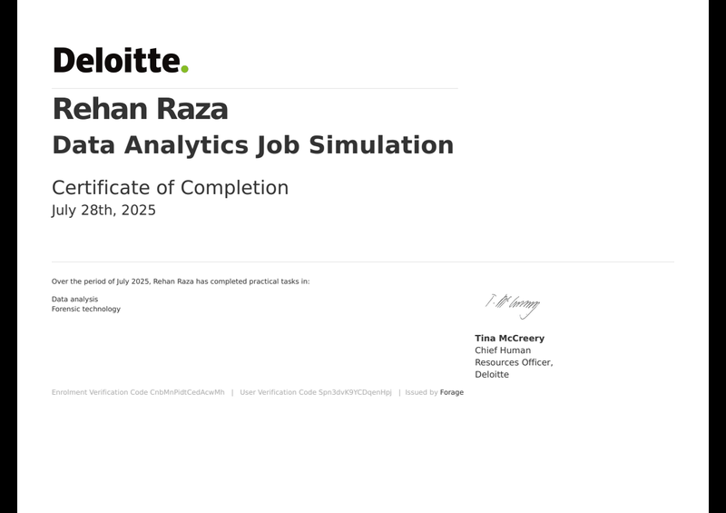
  </a>
  <br /><sub>🔍 <i>Click image to view high-resolution certificate</i></sub>
</div>

| Attribute | Details |
| :--- | :--- |
| **Issuing Organization** | Deloitte (via Forage) |
| **Credential Type** | `Virtual Experience / Job Simulation Certificate` |
| **Completion / Issue Date** | July 28, 2025 |
| **Credential ID** | `Enrolment: CnbMnPidtCedAcwMh | User: Spn3dvK9YCDqenHpj` |
| **Verification URL** | [🔗 Verify Credential Online](https://www.theforage.com/simulations/deloitte/data-analytics) |
| **Signatory / Authority** | Tina McCreery (Chief Human Resources Officer, Deloitte) |
| **Direct Certificate File** | [📂 Open File: `Deloitte-Data-Analytics-Job-Simulation.pdf`](Virtual-Internships-Job-Simulations/Deloitte-Data-Analytics-Job-Simulation.pdf) |

**📖 About the Certification:**  
Hands-on data analytics job simulation with Deloitte Australia focusing on forensic investigation and strategic analytics.

**🧠 Key Concepts Learned:**  
Analyzing complex datasets to detect forensic anomalies, verifying transaction integrity, and communicating analytical findings to executive stakeholders.

**🎯 Technical Skills Gained:**  
`Forensic Technology`, `Data Analytics & Profiling`, `Data Auditing`, `Client Presentation & Reporting`

**🛠️ Tools & Technologies:**  
`Data Analytics Tools`, `Excel / Tableau / Python`

**🚀 Practical Learning Outcomes:**  
Demonstrated competence in applying analytics for corporate audits, fraud detection, and business consulting.

<div align='right'><a href='#-table-of-contents'>⬆ Back to Top</a></div>

---

### 3. GenAI Powered Data Analytics Job Simulation

<div align="center">
  <a href="Virtual-Internships-Job-Simulations/Tata-GenAI-Data-Analytics-Job-Simulation.pdf" target="_blank">
    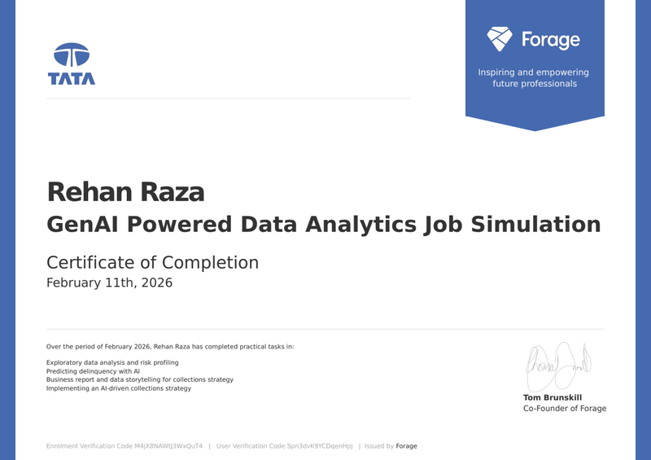
  </a>
  <br /><sub>🔍 <i>Click image to view high-resolution certificate</i></sub>
</div>

| Attribute | Details |
| :--- | :--- |
| **Issuing Organization** | Tata Group (via Forage) |
| **Credential Type** | `Virtual Experience / Job Simulation Certificate` |
| **Completion / Issue Date** | February 11, 2026 |
| **Credential ID** | `Enrolment: M4jX8NAWtJ3WxQuT4 | User: Spn3dvK9YCDqenHpj` |
| **Verification URL** | [🔗 Verify Credential Online](https://www.theforage.com/simulations/tata/genai-data-analytics) |
| **Signatory / Authority** | Tom Brunskill (Co-Founder, Forage) |
| **Direct Certificate File** | [📂 Open File: `Tata-GenAI-Data-Analytics-Job-Simulation.pdf`](Virtual-Internships-Job-Simulations/Tata-GenAI-Data-Analytics-Job-Simulation.pdf) |

**📖 About the Certification:**  
Advanced industry job simulation with Tata Group integrating Generative AI into enterprise data analytics and risk management workflows.

**🧠 Key Concepts Learned:**  
Conducting exploratory data analysis and risk profiling, deploying predictive AI models to forecast customer delinquency, and presenting AI-augmented data stories for business strategy.

**🎯 Technical Skills Gained:**  
`Generative AI Analytics`, `Exploratory Data Analysis`, `Delinquency Prediction`, `Data Storytelling`, `AI-Driven Business Strategy`

**🛠️ Tools & Technologies:**  
`GenAI Tools`, `Python`, `Predictive Modeling`

**🚀 Practical Learning Outcomes:**  
Hands-on ability to synthesize GenAI and traditional analytics into actionable corporate strategy.

<div align='right'><a href='#-table-of-contents'>⬆ Back to Top</a></div>

---

### 4. Operations Job Simulation

<div align="center">
  <a href="Virtual-Internships-Job-Simulations/Goldman-Sachs-Operations-Job-Simulation.pdf" target="_blank">
    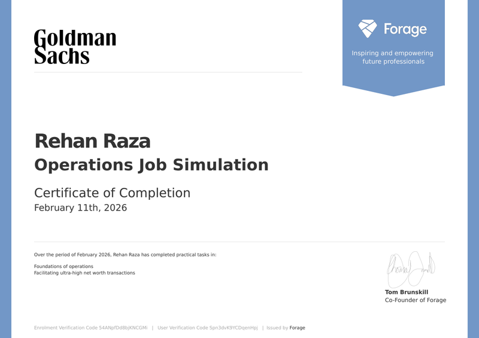
  </a>
  <br /><sub>🔍 <i>Click image to view high-resolution certificate</i></sub>
</div>

| Attribute | Details |
| :--- | :--- |
| **Issuing Organization** | Goldman Sachs (via Forage) |
| **Credential Type** | `Virtual Experience / Job Simulation Certificate` |
| **Completion / Issue Date** | February 11, 2026 |
| **Credential ID** | `Enrolment: 54ANpfDd8bjKNCGMi | User: Spn3dvK9YCDqenHpj` |
| **Verification URL** | [🔗 Verify Credential Online](https://www.theforage.com/simulations/goldman-sachs/operations) |
| **Signatory / Authority** | Tom Brunskill (Co-Founder, Forage) |
| **Direct Certificate File** | [📂 Open File: `Goldman-Sachs-Operations-Job-Simulation.pdf`](Virtual-Internships-Job-Simulations/Goldman-Sachs-Operations-Job-Simulation.pdf) |

**📖 About the Certification:**  
Specialized job simulation with Goldman Sachs diving into global financial operations, transaction verification, and institutional risk oversight.

**🧠 Key Concepts Learned:**  
Operational foundations, verifying settlement parameters for ultra-high-net-worth transactions, identifying discrepancies, and managing compliance.

**🎯 Technical Skills Gained:**  
`Financial Operations`, `High-Net-Worth Transaction Processing`, `Risk Management & Compliance`, `Operational Workflows`

**🛠️ Tools & Technologies:**  
`Financial Operations Frameworks`

**🚀 Practical Learning Outcomes:**  
Gained critical operational risk and compliance awareness essential for enterprise FinTech systems.

<div align='right'><a href='#-table-of-contents'>⬆ Back to Top</a></div>

---

## 💡 Design Thinking & Human-Centered Innovation

> *Elite NPTEL certification by IIT Madras covering user empathy, ideation, and rapid prototyping.*

### 1. Design Thinking - A Primer (Elite NPTEL Online Certification)

<div align="center">
  <a href="Design-Thinking/IIT-Madras-NPTEL-Design-Thinking-Primer.pdf" target="_blank">
    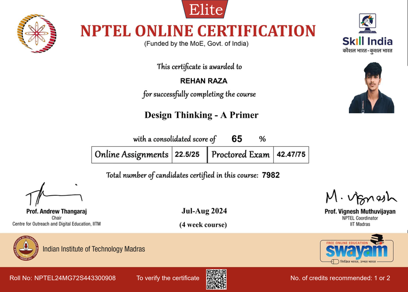
  </a>
  <br /><sub>🔍 <i>Click image to view high-resolution certificate</i></sub>
</div>

| Attribute | Details |
| :--- | :--- |
| **Issuing Organization** | Indian Institute of Technology Madras (IIT Madras) & NPTEL (MoE, Govt. of India) |
| **Credential Type** | `Elite Government of India NPTEL Online Certification` |
| **Completion / Issue Date** | July - August 2024 |
| **Credential ID** | `Roll No: NPTEL24MG72S443300908` |
| **Verification URL** | [🔗 Verify Credential Online](https://nptel.ac.in/noc) |
| **Performance / Score** | **Elite (Consolidated Score: 65% | Assignments: 22.5/25, Proctored Exam: 42.47/75)** |
| **Signatory / Authority** | Prof. Andrew Thangaraj (IITM) & Prof. Vignesh Muthuvijayan (IIT Madras) |
| **Direct Certificate File** | [📂 Open File: `IIT-Madras-NPTEL-Design-Thinking-Primer.pdf`](Design-Thinking/IIT-Madras-NPTEL-Design-Thinking-Primer.pdf) |

**📖 About the Certification:**  
Prestigious proctored 4-week Elite certification funded by the Ministry of Education, Govt. of India, conducted by IIT Madras.

**🧠 Key Concepts Learned:**  
The 5-stage human-centered design methodology (Empathize, Define, Ideate, Prototype, Test), conducting stakeholder interviews, creating user personas, and iterative testing.

**🎯 Technical Skills Gained:**  
`Design Thinking Process`, `Empathy & Needfinding`, `Ideation Techniques`, `Prototyping & User Testing`, `Human-Centered Design`

**🛠️ Tools & Technologies:**  
`Design Thinking Frameworks`, `Rapid Prototyping`

**🚀 Practical Learning Outcomes:**  
Verified competence in solving complex user problems through structured, innovative, user-centric engineering approaches.

<div align='right'><a href='#-table-of-contents'>⬆ Back to Top</a></div>

---

## 🎖️ General Awareness & Honors

> *Civic engagements, international relations quizzes, and multidisciplinary honors.*

### 1. MEA Quiz - Government of India

<div align="center">
  <a href="Other-Certifications/Ministry-of-External-Affairs-MEA-Quiz-Completion.png" target="_blank">
    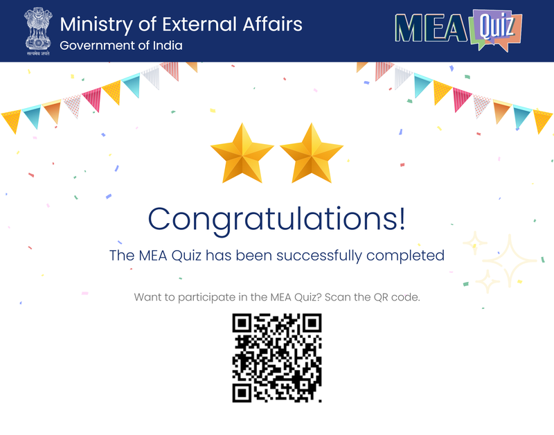
  </a>
  <br /><sub>🔍 <i>Click image to view high-resolution certificate</i></sub>
</div>

| Attribute | Details |
| :--- | :--- |
| **Issuing Organization** | Ministry of External Affairs (MEA), Government of India |
| **Credential Type** | `National Quiz Completion Certificate` |
| **Completion / Issue Date** | March 25, 2026 |
| **Credential ID** | *Not Available* |
| **Verification URL** | *Not Available* |
| **Direct Certificate File** | [📂 Open File: `Ministry-of-External-Affairs-MEA-Quiz-Completion.png`](Other-Certifications/Ministry-of-External-Affairs-MEA-Quiz-Completion.png) |

**📖 About the Certification:**  
National knowledge certification from the Ministry of External Affairs, Government of India, recognizing successful completion of the official MEA Quiz.

**🧠 Key Concepts Learned:**  
Diplomatic initiatives, global geopolitical engagements of India, and key milestones in international cooperation.

**🎯 Technical Skills Gained:**  
`International Relations Awareness`, `Indian Foreign Policy Knowledge`, `Current Affairs`, `General Awareness`

**🛠️ Tools & Technologies:**  
`MEA Quiz Portal`

**🚀 Practical Learning Outcomes:**  
Demonstrated broad general awareness and active civic participation.

<div align='right'><a href='#-table-of-contents'>⬆ Back to Top</a></div>

---

## 🌟 My Continuous Learning Journey

My growth as a Computer Science & Engineering (Data Science) undergraduate at Galgotias University has been defined by proactive learning and translating theoretical concepts into demonstrable engineering solutions:

1. **Strong Foundational Roots (C, Java, Python, and DSA):**  
   Beginning with low-level systems programming in C and object-oriented mastery in Java through GUVI and Apna College, I developed a deep appreciation for algorithmic complexity, memory management, and data structures. Solving over **250+ problems on CodeChef** and achieving the **HackerRank Software Engineer Intern Role Certification** solidified my analytical problem-solving foundation.

2. **Data Science & Analytical Thinking:**  
   Through IBM's Cognitive Class series and Infosys Springboard, I immersed myself in data manipulation with Pandas, NumPy, and statistical hypothesis testing. Complementing this with CodeChef's SQL Roadmap and Oracle Academy's Database Design, I mastered relational schemas, complex queries, and data extraction pipelines.

3. **Machine Learning, AI Agents & Ethical Governance:**  
   I advanced into predictive modeling with Scikit-learn, deep learning architectures during the **10-Week AI-ML Virtual Internship with Google for Developers**, and built autonomous agent systems during **HackerRank Orchestrate** (finishing ranked #2563 out of 4,094 participants). Concurrently, earning the **IBM SkillsBuild Responsible AI & Risk Management** credential instilled a commitment to mitigating algorithmic bias, ensuring transparency, and designing trustworthy AI systems.

4. **Cloud Infrastructure & Data Engineering on AWS:**  
   Recognizing that modern data systems operate on the cloud, I pursued comprehensive AWS training, culminating in the **AWS Academy Graduate Data Engineering badge (40 hours)**, **AWS Technical Essentials**, **Data Engineering on AWS Foundations**, and the prestigious **8-Week AICTE EduSkills Data Engineering Virtual Internship** (awarded Grade 'O').

5. **Enterprise Simulations & End-to-End Product Building:**  
   To test my skills against enterprise standards, I completed rigorous virtual job simulations with **JPMorgan Chase & Co.** (Kafka streaming, Spring REST APIs), **Deloitte** (forensic data analytics), **Tata Group** (GenAI-powered financial analytics), and **Goldman Sachs** (operations and transaction verification). I also engineered responsive full-stack applications utilizing the MERN stack.

6. **Human-Centered Innovation:**  
   Earning an **Elite Certification from IIT Madras (NPTEL)** in *Design Thinking - A Primer* taught me to place users at the center of technical innovation, from empathy gathering to rapid iterative prototyping.

---

## 🛡️ Repository Structure & Verification Policy

```text
My-Certification/
│
├── README.md                                    # Master portfolio documentation & verification index
│
├── AWS-Cloud/                                   # AWS cloud architecture, data pipelines & MLOps
│   └── previews/                                # High-resolution visual certificate previews
├── Data-Science-Machine-Learning/               # IBM, Infosys & CodeChef data analytics & ML tracks
│   └── previews/
├── Artificial-Intelligence/                     # Google Developers, IBM Responsible AI & HackerRank AI Agents
│   └── previews/
├── Programming-DSA/                             # Java, Python, C, Apna College DSA & CodeChef milestones
│   └── previews/
├── Full-Stack-Development/                      # MERN stack, React.js frontend & Node.js backend
│   └── previews/
├── Database-Management/                         # Oracle Academy database design & data modeling
│   └── previews/
├── Virtual-Internships-Job-Simulations/         # JPMorgan, Deloitte, Tata & Goldman Sachs industry simulations
│   └── previews/
├── Design-Thinking/                             # IIT Madras / NPTEL Elite certification
│   └── previews/
└── Other-Certifications/                        # National quiz honors & civic accomplishments
    └── previews/
```

### 🔒 Authenticity & Verification Statement
- **No Fabricated Information:** Every credential ID, issuing organization, completion date, and syllabus topic is directly derived from the official certificate artifacts.
- **Credential Differentiation:** Clear distinctions are maintained between **Course Completion Certificates**, **Virtual Internships**, **Competitive Hackathon Achievements**, **Role Certifications**, and **Elite Proctored Examinations**.
- **Direct Verifiability:** Official verification URLs and Credly links have been provided wherever available for instant third-party validation.
- **Preservation of Quality:** Original PDF and image assets are preserved with 100% byte fidelity without compression or alteration.

---

## 📬 Contact & Connect

- **Name:** Rehan Raza
- **Degree:** B.Tech Computer Science & Engineering (Specialization in Data Science)
- **Institution:** Galgotias University, Greater Noida, India
- **Gmail:** 099rehan@gamil.com
- **GitHub:** [@Rehanraza009](https://github.com/Rehanraza009)
- **Portfolio Repository:** [https://github.com/Rehanraza009/My-Certification](https://github.com/Rehanraza009/My-Certification)

<div align="center">
  <sub>Built with precision and pride. © 2026 Rehan Raza. All rights reserved.</sub>
</div>
